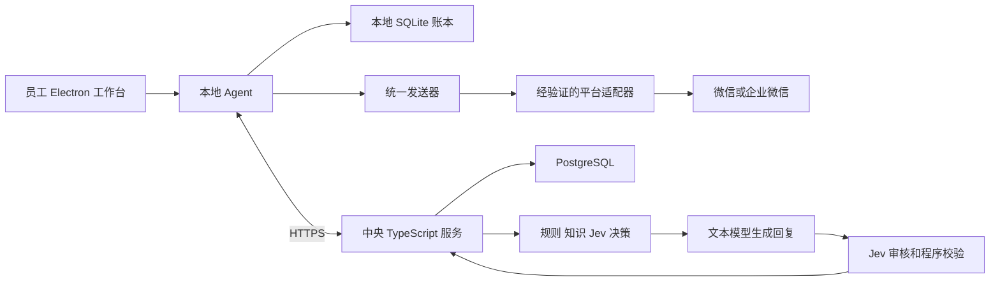
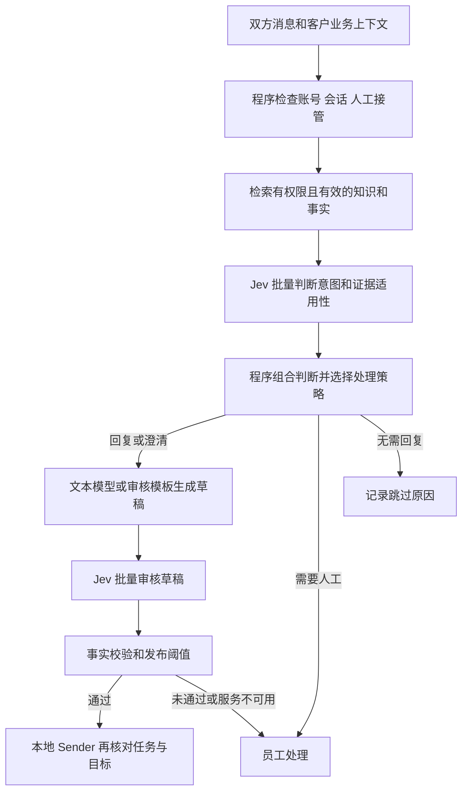

# AutoReply 多员工客户私聊开发计划

2026-10-08 当前安排：按用户最新要求加快推进，严格控制原需求范围，优先补自动回复/Jev/多账号办公主线缺口，只保留必要开发与验证。新 Windows 开发安装候选已完整构建并通过同构建包内、桌面、反馈与安装内容核对，最新凭据保护代码已入包，见 [安装候选](windows-installer.zh-CN.md)。未执行安装或实机聊天，原后台私聊、真实业务/费用与多电脑验收仍待完成；实机继续暂缓，完整目标不缩减。下文为历史记录。

2026-10-08 D10/D15 整链路补验：当前候选完整隔离发布 **55/55**，新增真实中央 HTTPS/Windows safeStorage 的两合成员工、三独立进程登记/保存/重启/续租/撤销检查；六种地址/范围错绑在请求前拒绝，撤销其中一人不影响另一人。原两组完整 Jev 三臂实验和 54 项保留，15 秒子阶段、10 秒租约、原样本/命令期限未放宽，类型与目标 lint/格式通过，源/候选/隔离输出摘要复核通过，详见 [主线记录](mainline-development.zh-CN.md)。这只证明本机开发环境与隔离合成账号整链路，安装、另一用户、多电脑、原后台私聊、真实精度/费用、最终准入及试点仍须完成；供应商/账单来源待明确，实机继续暂缓。下文记录是历史时点。

2026-10-08 D10/D15 新进展：设备令牌已与企业服务地址和五项设备身份共同加密，地址/范围改写、旧裸令牌或坏密文在发请求前拒绝；旧设备升级需管理员核对后重新登记。源码 88 项、真实 Windows 加密/跨进程读取和十项拒绝、当前生产构建及默认桌面启动/退出检查通过，三类类型和目标 lint/格式通过。首轮错误通过的超期限检查和源码断言失败均保留，15 秒加密检查期限未放宽；详细边界见 [主线记录](mainline-development.zh-CN.md) 与 [设备凭据](device-credentials.zh-CN.md)。安装端、另一 Windows 用户、中央真实注册与加密整链路及多电脑未验收。继续原供应商/业务/最终准入与后台驱动工作，实机暂缓、生产批准关闭、完整目标未完成。下文记录是历史时点。

2026-10-08 已把结算声明接入中央完整校准/留出核验，新增 `correlate-settlements`：同账号事务验证封存、原调用和最新独立审核后逐请求关联金额；入口快照及严格声明防止覆盖冻结证据。源码 113 项、真实 PostgreSQL 24 项、新候选隔离发布 54 项通过；两组合成实验各执行完整 900 结果/1800 模拟请求，包内完整/缺行命令及撤权/旧审核拒绝均已实测，类型和目标 lint/格式通过，详见 [主线记录](mainline-development.zh-CN.md)。中央记录核验已接通，但声明金额、来源元数据哈希和手填账号仍不认证真实账单，费用预算/业务真值/放行保持 false。后续顺序：明确供应商和可验证账单来源，接原始账单适配器及来源/账号核验；验收真实业务独立盲评与最终准入；测试条件就绪后验收原后台私聊、安装、多账号边办公及多电脑。实机和付费试验继续暂缓，生产批准关闭，完整目标未完成。下文是历史时点记录。

2026-10-08 已实现完整三臂的逐请求结算关联算法及 `jev:settlements` 私有文件命令，失败重试、未知费用、重复记录和最大单轮预算都有明确处理；归一化声明仍不能认证真实账单。源码 75 项、编译命令 10 项通过，服务/服务器类型、目标 lint/格式通过；实际定位测试的大文件深比较开销，保留完整字节相等验证和原期限，首轮命令超时根因仍未证明，详见 [主线记录](mainline-development.zh-CN.md)。后续顺序：在供应商/可验证结算来源明确后实现账单适配器与独立来源核验；关联中央最新封存/审核和真实业务统计，实施最终准入；测试条件就绪后验收员工原后台私聊、安装、多账号办公及多电脑。当前实机暂缓，生产批准关闭，完整目标未完成。

2026-10-08 已补完整缺用量流程：两个独立合成账号各重新执行 100 校准/200 留出的全部三臂；缺用量轮恰好一条目标响应缺 usage，中央/公开 CLI 保持未知数据和费用，不生成统计文件。去除重复标签摘要、保留数字表示严格校验、修空预期哈希守卫，并在独立命令结束后关闭权限解释器的一秒驻留。最新源码 43 项、数据库 35 项、新包隔离 54 项通过；原期限、完整工作量和所有失败报告保留，重叠计数不累加，范围见 [主线安排](mainline-development.zh-CN.md)。下一步接真实供应商结算和最终准入，供应商/可验证结算来源仍待明确；生产批准关闭。原员工后台私聊、真实精度/费用、安装、多账号办公和多电脑仍未验收，实机继续暂缓，完整目标未完成。

2026-10-08 已补公开 `verify-holdout` 命令和不同真实快照统计：100 校准与 200 留出分别核验，只统计留出效果，保留原 2000 次 bootstrap 与验收门槛。完整编译流程仍为 900 份结果/1800 次模拟 HTTP，合成报告明确标记来源和未验证业务真实性，实际基线零错误返回证据不足。最新源码 52 项、真实数据库 21 项、候选隔离 53 项通过，已检查实际独立统计文件及撤权/旧审核拒绝；详情与审计见 [主线安排](mainline-development.zh-CN.md)。下一步补完整响应缺用量流程，再接真实结算和最终准入。费用未知、生产批准关闭；真实业务准确度、原员工后台私聊、安装、多账号办公及多电脑仍未验收，实机继续暂缓，完整目标未完成。下文记录保留历史代码时点。

2026-10-08 完整留出流程已补：100 校准/200 留出案例的全部三臂经编译核心和真实 PostgreSQL 保存 900 份结果、1800 次模拟请求，独立 LOGIN 提交完整标签；中央在同账号事务内重算校准并核验目标冻结、留出封存及最新审核，拒绝删结果、改标签、混用版本和旧审核。源码 33 项、原生数据库 28 项、新包隔离 53 项通过，原期限不变，首次编译失败及阶段诊断缺失保留。详细范围见 [主线安排](mainline-development.zh-CN.md)。下一步补内部核验 CLI、不同快照的统计准入协议与真实供应商账单关联；费用未知、新协议生产批准继续关闭。真实业务精准度、原员工后台私聊、安装、多账号办公与多电脑仍未验收，实机继续暂缓，完整目标未完成。

2026-10-08 编译命令与并发边界已补：完整原生协议 17 项（新增三项实际锁顺序）、共享 PGlite 14 项和同候选新隔离检查 53 项通过；包内真实 `calibrate → freeze-holdout` 命令基于完整 100/300/600 模拟记录运行，独立审核用真实专用 LOGIN，重试/拒绝及无审批/发送均已核验。观察期限和原 CLI/完整臂期限保持，范围及报告见 [主线安排](mainline-development.zh-CN.md)。下一步逐条执行原定 200 条留出三臂、独立审核和真实账单关联，完成最终准入；真实精准度和费用、员工原后台私聊、实际安装、多账号办公及多电脑仍未完成，实机继续暂缓。

2026-10-08 留出冻结已接通：`eval:jev freeze-holdout` 在同一账号事务中，从完整封存和最新独立审核重算校准推荐，保留原知识/模型及 100/200 切分，生成新版本和中央关联；原留出已执行、跨 run 提前使用、旧审核、改回执都拒绝，已启动留出也在每次新调用前重查审核。主线九文件 135 项、盲评/转换专项 56 项、实际 PostgreSQL 28 项及新包 52 项通过；检查范围、性能修复和首次失败见 [主线安排](mainline-development.zh-CN.md)。下一步验证编译版完整冻结命令及并发冻结/留出启动两种顺序，再完成账单来源、原定留出独立审核与最终准入。真实精准度和费用、员工原后台私聊、实际安装和多电脑办公仍未完成；实机暂缓继续有效。

2026-10-08 候选事先登记已实现：新增迁移 049 和 `eval:jev declare`，冻结实验在任一执行开始前固定完整候选与目标；中央校准前后核对记录，拒绝事后补登记或改范围，同内容重试取原回执。六文件 142 项、真实 PostgreSQL 并发 8 项、实际发布包 52 项及类型/目标 lint 通过，首次缺失导入和观察器匹配失败保留，详见 [主线安排](mainline-development.zh-CN.md)。下一步将校准推荐关联到新冻结、证明原定留出组未提前使用、接入真实结算和最终准入。新协议批准仍关闭，真实精度、后台私聊、实际安装和多员工办公未完成；实机继续暂缓。

2026-10-08 中央校准已接通：新增 `eval:jev calibrate`，从实际中央冻结、完整三臂封存和最新独立审核推导 C 臂校准观察；保留完整样本，拒绝留出集和中途审核修订，不产生发送权。五文件 130 项、同候选独立部署复验 51 项及服务类型/目标 lint/格式通过；首次命令两项失败和管理员帮助四秒超时记录保留，超时原因仍未确认。步骤和验证范围见 [主线安排](mainline-development.zh-CN.md)。后续先完成中央候选事先登记、未参与校准的留出证据与真实账单最终准入，再开展授权的业务和实机验收；真实精准度、后台私聊、安装、多员工办公仍未完成，实机继续暂缓。

2026-10-07 完整校准样本：明确人工请求且实际没有执行模型的案例现在允许保留空前置响应，仍必须无草稿/复审并始终交人工；其他缺失响应继续拒绝，不降低样本数、不补造用量或模型结果。五文件 116 项、包含编译校准器的新包隔离部署 51 项、服务类型及目标 lint/格式通过，首次四项失败和旧包实际失败保留，见 [主线安排](mainline-development.zh-CN.md)。继续完成中央完整校准/留出、独立审核和真实账单最终准入；真实精准度、后台私聊、实际安装和多电脑办公仍未验收，实机继续暂缓。

2026-10-07 校准与启动增量：`jev:calibrate` 已统一私有文件权限、大小、严格编码和排他同步写入；服务入口先验证配置/TLS，再加载业务模块，原业务函数体编译比较未改变。相关四文件 36 项、启动/学习停机 27 项、新包隔离部署 50 项及服务类型/目标 lint 通过；原超时和首次六项失败均保留，详见 [主线安排](mainline-development.zh-CN.md)。下一步继续中央完整校准/留出及真实账单最终准入；真实业务准确度、后台私聊、实际安装和多电脑办公仍未验收，实机暂缓保持。

2026-10-07 Jev 合同修复：实际复现并修复未知原型名称被误接受、结构化评分说明调序被误拒绝，按官方合同提前拒绝无效顶层评分内容；阈值与自动范围未改变。六文件 104 项、新包实际编译客户端及部署 50 项通过，三类和独立服务类型、目标 lint/格式通过；保留修复前13/20报告。证据及公开接口范围见 [主线安排](mainline-development.zh-CN.md)。中央最终准入的完整校准/留出、独立标签与真实账单关联仍待实现和验收；真实供应商、业务样本、后台驱动、多电脑与实机暂缓等原标准不变。

2026-10-07 管理员部署增量：已统一管理员 CLI/HTTPS 网关专用身份检查，提前验证 TLS 并处理启动/停机清理；补全空网关配置模板。新独立包隔离验证 49/49、完整 TLS 入口 8/8、类型和目标 lint/格式通过。真实管理员 CLI 创建的两个合成账号经 HTTPS 登记和刷新，默认暂停且租约被拒绝，审计完整；原包接受混用身份的实际失败保留。报告、首次单元失败及边界见 [主线安排](mainline-development.zh-CN.md)。下一步仍须真实配置发布/业务验收、安装端加密与多电脑、后台驱动和生产服务管理；实机继续暂缓，完整目标保持。

2026-10-07 HTTPS/员工连接：独立发布包扩展验证 26/26 通过，实际 HTTPS 服务与当前员工登记模块完成两个合成账号的登记、刷新、租约和撤销拒绝，另一个账号保持可连接；类型和目标 lint 通过。操作及报告见 [主线安排](mainline-development.zh-CN.md)。测试使用公共证书、显式测试 CA 和本地加密替身，运维直接准备账号，不代表管理员发布、安装端加密或生产多电脑验收。接下来补管理员到员工的部署流程，再按测试条件恢复真实客户端及 Jev 业务评测；实机仍暂缓，完整目标与标准保留。

2026-10-07 服务端启动可靠性：已修复数据库建立后的模型配置错误未清理连接，以及监听错误未进入统一处理；后台仅在监听成功后启动，退出等待 HTTP/后台排空再关闭全部池，任何清理失败会报告失败。新独立发布包真实 PostgreSQL/HTTP 20/20、完整学习 worker 18/18、TLS/入口 6/6通过，类型与目标 lint/格式通过；旧包非法模型端点 6 秒超时证据保留，原期限未变。初次空配置失败原因仍未知，不与后续复现的故障混淆。详见 [主线安排](mainline-development.zh-CN.md)。这是限定开发验收，实机继续暂缓，真实供应商结算、业务效果、后台收发、多员工办公及完整 D00–D20 发布标准不变。

2026-10-07 D10/D15 交付增量：已实现独立中央服务编译候选，含自己的锁文件、共享 JS 模块和全部 48 个迁移，运行无需 Electron/tsx。真实干净临时目录生产安装与隔离 PostgreSQL/HTTP 验收 14 项通过，服务端类型和目标 lint/格式通过；保留首次入口检查失败、原期限及 Windows 停止验证边界。命令、报告和部署步骤见 [主线安排](mainline-development.zh-CN.md) 与 [部署说明](../server/deployment.zh-CN.md)。这不完成生产发布、真实模型精准度或后台私聊收发；实机继续暂缓，完整 D00–D20 标准保持。

2026-10-07 当前执行进展：完整 `verify` 通过（三类类型、quiet lint、930 单元/34 回归），另外完成原生 PostgreSQL 独立审核并发验证 10/10，覆盖重复收据、全局修订、撤权与实际共享锁等待；完整校准 100 案例/300 臂、原期限与失败记录保留，隔离容器已清理。完整验证范围、三次失败及最新源检查见 [主线安排](mainline-development.zh-CN.md)。真实供应商与结算证据、独立业务精准度、微信/企微后台驱动、多员工办公及正式发布仍未验收，实机继续暂缓，完整 D00–D20 目标保持。

2026-10-07 本轮收尾：独立标签导入新增输出前二次中央核验，拒绝中途修订或资格变化；按实际 SQL 耗时优化中央完整核验查询，保留账号锁、RLS及所有原结果核对。正式六模式 CLI 14/14、执行/封包 21 项通过，完整 100 案例／300 分片合法导入记录 1351 ms，原期限和失败记录保留；最新类型及相关 lint/格式通过。操作和下一步见 [主线安排](mainline-development.zh-CN.md)。仍待真实文本供应商与认证账单、独立业务评测和最终准入，用户实机暂缓及原多员工办公/正式发布标准保留。

2026-10-07 最新执行进展：独立数据库审核身份与标签修订已实现，评测入口增加 `review-submit`，导入必须核对 `--review-id`；供应商请求编号随调用账本封存，完整私有分片读取刷新每个文件权限。标签数据库 12 项、六模式 CLI 13 项、传输 21 项、最终三文件 39 项通过，重叠复验不累加；失败记录及下一步见 [主线安排](mainline-development.zh-CN.md)。接下来仍需真实文本供应商及认证账单、独立业务样本评测、完整校准/留出准入。微信/企微实机继续暂缓，多员工办公和正式发布要求保持。

2026-10-07 保留成果并继续暂缓实机。离线五模式命令联调 6 项通过：完整校准切分、真实私有文件权限、中央封存、盲评与标签导入、限额失败及重复生成拒绝。大结果改为完整分片清单，大评审视图分页，读取按需分配，私有输出增加文件同步；没有缩小样本或调宽期限。清单/分页与私有文件 31 项、封包复验 12 项及新增首次封存定向 1 项通过，最新服务类型及相关 lint 通过。此前超时、真实 fixture 拆分与独立报告见 [主线安排](mainline-development.zh-CN.md)。真实供应商、独立审核身份与账单的最终准入仍待完成；真实后台收发、业务效果、多人办公和发布标准保留。

2026-10-07 Jev 中央证据增量：已补完整草稿/实际调用封存及首个盲评包封存，CLI 生成与导入均核对中央原值；手工改写本地结果不能据此取得新协议批准。新协议审批暂以 `central_replay_evidence_required` 拒绝，待独立审核身份、账单与完整校准/留出证据接入后再开放。整合 8 文件 123 项、真实 PostgreSQL 独立连接专项 4 项通过，服务类型与修改文件 lint 通过；这些验证含合成夹具，没有真实付费或业务精度结论。操作和边界见 [主线安排](mainline-development.zh-CN.md)。原实机暂缓及完整验收标准保持。

2026-10-07 Jev 主线增量：独立 A/B/C 的生产 HTTP 客户端接入、持久调用次数限额/不可变回执、匿名盲评与标签导入已实现，命令和边界见 [评测操作](../evals/jev/README.md)。定向整合 94 项与真实 PostgreSQL 独立连接专项 3 项通过；尚未进行真实供应商业务评测、计费验证或生产 CLI 完整验收。用户继续暂缓微信/企微实机；后台收发、多员工办公与正式发布等原标准保持待办。

2026-10-07 根据用户对速度的要求，已授权多智能体并行推进，当前执行优先级调整为 [自动回复主线安排](mainline-development.zh-CN.md)：收尾已有恢复改动后，集中完成采集→Jev→生成→复审→发送/人工接管，随后完成两平台真实驱动和业务效果验收。下方历史记录中的恢复“下一步”不再决定当前优先级，原完整验收要求保留。

2026-10-07 D16 已补 [账号全部恢复案核对](restore-completion-audit.zh-CN.md)，避免一份设备回执掩盖其他未完成恢复案；全量截止时间、完整摘要和原签名/裁定复核已实现。最终相关 107 项和实际 PostgreSQL 全量 78 项通过，原失败保留，见 [执行记录](superpowers/plans/2026-10-07-restore-completion-audit.md)。下一步连接不可变最终准入、中央/本机运行与发送校验和员工完成流程；完整目标、真实微信/企微后台、Jev 业务效果、多人办公与正式发布标准保持。

2026-10-07 继续落实 D16：已实现 [持久化恢复确认声明](superpowers/plans/2026-10-07-restore-completion-declaration.md)、原请求断线/重启重试、不可变中央回执和审计。新增真实过期重试与独立 PostgreSQL 账号锁/撤销专项通过，完整回归仍有保留失败，不将其写为整体通过。下一步接通所有相关恢复案的最终准入及员工完成流程；真实微信/企微后台收发、Jev 业务评测、多员工电脑和正式发布仍按原目标执行。

2026-10-07 继续落实 D16：已接通恢复后的旧历史隔离与独立签名的新消息顺序校验，分页事务、重启、新恢复和来源撤销均列入检查。相关二十文件 357 项、真实 PostgreSQL 专项 8 项通过；后续四文件 85 项与最终三文件 40 项补验另列，不累加。下一步补中央最终完成、全部恢复来源核对和准入流程；微信/企微实际后台驱动、Jev 业务准确度、多人办公及正式发布仍按原验收执行。见 [开发记录](superpowers/plans/2026-10-07-restore-ordered-observation.md)。

本计划用于在当前 AutoReply 项目上开发微信和企业微信客户私聊助手，满足多个员工账号使用、员工在日常电脑上继续办公的要求。接入用户已确认的 TypeSafe Jev，在回复前判断客户意图和处理策略，在回复生成后检查内容是否切题、有依据。文本模型负责组织语言，本地程序负责最终发送校验。

执行分为两条可并行验证的路线：桌面侧验证后台收发并重建可靠执行流程；回复侧用同一批业务对话评估 Jev 对准确度的实际改善。两条路线在多员工系统中汇合，全部验收通过后发布。

2026-10-07 D16 恢复设备核对：已接通 [原独立执行证据在恢复设备重新保存](superpowers/plans/2026-10-07-restore-resolution-reapplication.md)，凭据限定完整原报告/裁定/封存记录，本地逐笔匹配后以不可变事务保存，断网与重启可续接。原未知记录与发送围栏保持；恢复核对仍不代表自动回复功能已通过实机验收。当前相关十九文件 337 项、真实 PostgreSQL 七文件 75 项通过并清理容器，最终类型及后续观察见执行记录。下一步继续原 Task 3/4 的历史重读、中央精确完成确认与本地/中央准入，微信/企微后台驱动、Jev 业务评测、多个员工电脑和正式交付保持原标准。

2026-10-07 D16 逐笔发送核验：已接通 [独立维护核验保存与管理员只读命令](restore-execution-review.zh-CN.md)，覆盖完整本地执行及中央许可，不允许用消息不存在推断未发送；原请求、服务端待核验快照、实际维护主体和回执不可变保存，原未知结果不改写。完整工作区 163 文件 1663 项、相关十一文件 128 项、最终真实 PostgreSQL 七文件 70 项、三类类型和十三文件 lint 通过，容器已清理。两次完整数据库失败及夹具修正保留，不将复验通过当作长期稳定性证明，见 [执行记录](superpowers/plans/2026-10-07-restore-execution-review.md)。原 Task 3/4 的最终批准、新消息运行边界和精确准入仍待完成，真实平台/业务/多电脑目标继续推进。

2026-10-07 D16 维护登记增量：已完成 [独立维护登记和公钥撤销](restore-history-maintenance.zh-CN.md)，维护要求绑定全部当前核对依据，原请求/实际维护主体/回执同事务保存；普通管理员只能引用，不能自填来源和停止事实。真实公钥事务锁串行核验与撤销，输出补 Windows 私有权限和同步落盘。九文件 92 项、实际 PostgreSQL 全量 69 项、三类类型和十一文件 lint 通过；实际 CLI 原编号重试和错误数据库/角色拒绝已验证。维护人员仍须独立核验实机事实，没有生产来源启用或恢复放行，下一步继续原 Task 3/4 的最终批准、新运行边界和本地/中央精确准入，见 [执行记录](superpowers/plans/2026-10-07-restore-history-maintenance.md)。

2026-10-07 D16 后续验证：在新隔离 PostgreSQL 容器中完整七文件 65 项通过，容器已清理，包含此前失败的学习迭代/回放及新历史证据保存。补充下条首次失败记录；当前完整并发有通过证据，但未冻结工作区/依赖、未确定此前学习失败根因，也不是全库或真实业务验收。维护登记、最终恢复准入和真实平台/业务/多电脑任务继续推进，详见 [执行记录](superpowers/plans/2026-10-07-restore-history-records.md)。

2026-10-07 D16 认证保存：历史证据的 [管理员命令与不可变记录](restore-history-proof.zh-CN.md) 已接通，绑定维护侧独立要求和当前完整核对依据。108 项与真实 PostgreSQL 专项两项通过；完整并发仍有保留的学习失败，未认定全库通过。下一步完成维护事实审核登记、最终批准、运行边界及本地/中央准入，原 Task 3/4 继续未完成，见 [执行记录](superpowers/plans/2026-10-07-restore-history-records.md)。

2026-10-07 D16 完整历史前置：已实现 [独立来源签名与完整清单核对](restore-history-proof.zh-CN.md)，三文件 29 项及实际 SQLite 备份恢复联调通过，拒绝用员工界面的一页替代全部清单。签名不证明来源没有隐瞒未知消息；生产历史来源仍须实际验收，可信备份起点和恢复后设备停止核验不得猜测。下一步接通认证保存与完整证据复核，再推进最终恢复批准、本地/中央准入；原 Task 3/4 和 D16 整体验收保持未完成。

2026-10-07 D15 构建输入：[`build:win:dev` / installer 开发命令](release-source-snapshot.zh-CN.md) 已接通私有源码副本与构建后摘要核验。644 文件的新目录包、同副本 27 项、包内运行和默认桌面模拟通过；当前审计零漏洞。依赖/SDK 仍共享，完整回归、签名、干净安装/升级/卸载及真实平台/多人验收保持待办，见 [执行记录](superpowers/plans/2026-10-07-release-source-snapshot.md)。源码固定只提高构建证据一致性，不授予自动发送能力。

2026-10-07 D02 离线报告分析：[`probe:compare`](platform-probe-comparison.zh-CN.md) 已可直接比较同实例、版本、辅助包与采样范围下的 control/raw 数量和声明模式；不构造消息树、不推断客户身份或平台收发能力。同步修复当前用户仅有 Modify 权限的项目盘上私有目录保护失败，保持严格 ACL。55 项、实际 CLI 与构建通过；实机矩阵、后台生产驱动和准确度验收保持待办，见 [执行记录](superpowers/plans/2026-10-07-platform-probe-comparison.md)。

2026-10-07 D02/D03 期间观察：辅助 0.4.0 已接通只读桌面活动汇总，补充起止前台相同仍可能中途变化的诊断缺口。前台/焦点事件、鼠标/剪贴板序号/最近输入时间戳变化及采样间隔、故障、退出确认已在自建窗口验证；不保存输入内容，也不能据零变化证明无干扰或将会话活动归因于程序。真实平台后台收发和办公并行验收保持待办，见 [执行记录](superpowers/plans/2026-10-07-desktop-activity-probe.md)。

2026-10-07 D13 更新：已接通员工主进程运行元数据上报与企业管理员分页查询，包含防重放、最近/过期/撤销标识、中央暂停回执处理及退出取消。操作及验证见 [员工设备运行监控](runtime-monitoring.zh-CN.md)。已新增现有桌面页面中的 [管理员入口与独立管理服务](admin-console.zh-CN.md)，支持认证、设备分页、全员暂停与原批次核对；真实 HTTPS 部署、发送器停止证明、至少三台员工电脑及业务准确度验收保持待办。

目的绑定暂停继续推进：新增原目标快照、挑战、停止确认与同进程/轮次状态核对，详见 [账号暂停与停止确认](account-pause.zh-CN.md)。现已接入 [企业全员暂停](bulk-pause.zh-CN.md)，原账号清单、子请求与审计同事务保存，并支持超过 200 账号的完整分页及原批次幂等读取。管理界面已接通该流程，继续做真实部署、驱动停止证明与多电脑联调；现有确认不能解除任何发送或恢复围栏。

**第一个交付物是后台能力实测结论。只有通过实测的平台、客户端版本和操作场景，才能开放自动发送。** 当前项目依赖鼠标、剪贴板和按键，不能直接承担“不干扰员工办公”的承诺。修复执行流程可以降低串客户、漏处理和重复发送风险，但不能创造聊天客户端未提供的后台操作能力。

2026-10-07 D02 原始视图：已发布辅助 0.3.0，为只读命令增加 `--tree-view control|raw`，可分别检查控件视图过滤前后的结构；原始节点的存在不构成客户身份、消息可读或发送能力证明。自建 WPF 的实际视图差异、严格返回绑定和旧格式验证已经通过，微信/企微 raw 仍待采样。执行与验证见 [原始视图记录](superpowers/plans/2026-10-07-native-raw-view.md)，完整实机标准保持不变。

2026-10-07：计划中的只读 [`probe:read` 命令](platform-probe-command.zh-CN.md) 已接通，需指定已完成的原生发布编号；准备后续两平台版本/窗口绑定证据，尚不读取真实聊天文本或实现发送。微信 `4.1.15.13` 已有控件缺失的历史证据，生产驱动必须取得新的平台能力依据后实施。

本文是开发和验收计划，2026 年 10 月 2 日更新。开发已开始，当前进度和证据见 [实施状态](implementation-status.zh-CN.md)。已完成编辑重审、独立人工确认及统一发送的合成闭环，员工可查看意图、处理建议、审核原因和引用资料，并通过只读分页核对原知识版本的完整条目；管理员可为已有未知许可开不可变核对单、追加证据备注；员工主进程及中央已接通取证报告协议，核对按钮、管理员独立结案及本地原子恢复已通过合成验证；真实平台取证和生产恢复仍待验收。加入独立的 20 Agent / 10000 消息容量回放，已用合成中文问题完成一次 Jev 官方接口连接验证。用户暂缓实机探测，继续开展不依赖实机的开发。业务准确度、微信与企微后台收发、多台员工电脑试点尚未验收。构建通过不等于安装包和真实自动回复通过。

## 开发起点和首版边界

| 项目     | 已确定内容                                                              |
| -------- | ----------------------------------------------------------------------- |
| 工作目录 | `E:\wechat-autoreply\auto-reply`，所有开发命令在此目录执行              |
| 上游     | `https://github.com/DreDabe/auto-reply.git`                             |
| 基线     | `main`，版本 `1.2.4`，提交 `ed1d83ebc33e9471de4b4536ffd997d789eb008f`   |
| 已有技术 | Electron、React、TypeScript、RobotJS、视觉模型、模式配置和轨迹展示      |
| 业务范围 | 员工现有微信或企业微信账号与客户的一对一聊天                            |
| 必须交付 | 多员工账号隔离、人工优先、任务可追踪、统一发送、暂停可靠、异常可恢复    |
| 决策模型 | TypeSafe 官方 Jev；回复前决策与生成后审核纳入首版范围                   |
| 效果目标 | 以实际业务评测证明错答减少、人工修改减少；不能用 Jev 自评分代替效果验收 |
| 保留基础 | Electron 外壳、React 界面、模式编辑、配置界面、必要的截图工具和轨迹展示 |
| 重点重建 | 会话身份、消息观察、任务调度、发送记录、模型合同、多人配置与执行权      |

以下是排期假设，不是已经确认的部署条件：首版覆盖经过测试的 Windows x64 环境；每台员工电脑运行一个 Agent，首版每个 Agent 绑定一个当前登录的业务账号；多账号通过多台员工电脑同时运行实现。一机多开、同机微信和企微双账号同时自动运行、macOS、群聊、主动营销群发均不计入本轮首版验收。

微信和企业微信分别验证、分别列兼容版本，不能以企微成功替代微信验收。如果任一平台不支持不干扰办公的自动发送，该平台的全自动交付保持未通过；可交付的辅助回复能力单独标识，不将其写成原需求已经完成。

试点暂按 3 名员工联合测试、通过后扩大到 5 至 10 名员工安排；模拟测试覆盖 20 个 Agent。实际员工数量、峰值消息量、客户端版本和业务 FAQ 在 D00 登记后调整这些测试参数。模拟容量不代表已证明同等实机容量。

## 当前代码必须解决的问题

| 问题                                                             | 现有代码位置                                                                           | 对应任务      |
| ---------------------------------------------------------------- | -------------------------------------------------------------------------------------- | ------------- |
| 迟到模型结果使用共享 `activeHandler`，事件没有绑定原任务         | `src/core/generic-channel-session.ts`、`src/core/session-types.ts`                     | D01、D05      |
| 发送后刷新截图基线，可能吞掉生成期间新增消息                     | `src/core/generic-channel-session.ts`、`src/core/device.ts`                            | D04           |
| 停止时清队列，但没有完整取消和等待正在执行的操作                 | `src/core/runtime-host.ts`                                                             | D05           |
| 手动发送传裸文本并绕过调度，无法复核原账号和客户                 | `src/main/index.ts` 的 `reply:send`、`src/renderer/src/App.tsx`                        | D06、D07      |
| 按键完成就当成功，连续尝试发送快捷键且覆盖剪贴板                 | `src/core/rpa/input-utils.ts`                                                          | D03、D06      |
| 默认回复实际来自内置 bundle，修 `AIClient` 不覆盖全部请求        | `src/main/provider-bundle.ts`、`resources/providers/volcengine-ark/provider.bundle.js` | D08           |
| 模式底稿、经验、窗口缓存缺少账号和客户隔离                       | `src/main/index.ts`、`src/core/memory/`、`src/core/rpa/`                               | D04、D09、D13 |
| 通用 IPC、本地控制端口和主进程加载外部 Provider 扩大多人部署风险 | `src/preload/index.ts`、`src/main/skill-server.ts`、`src/main/provider-bundle.ts`      | D07、D15      |

这些结论来自当前代码和前期模拟复现；真实客户端上的成功率、延迟、版本兼容性仍须实测。`globalAutoReply` 目前参与默认模式配置，新版必须另设含义明确的总暂停，不能仅凭字段名将原逻辑视为全局停止机制。

## 目标结构和技术选择



本地 Agent 负责观察、人工接管、最终发送判断和崩溃恢复；中央服务负责员工设备登记、账号执行权、已发布配置、知识、Jev 决策和回复生成。服务器返回绑定任务、输入版本和审核版本的草稿，本地复核后才决定是否发送。Jev 不持有桌面操作权限，也不选择目标账号或聊天窗口。

| 部分         | 首版实现决策                                                                                                                         |
| ------------ | ------------------------------------------------------------------------------------------------------------------------------------ |
| 桌面应用     | 保留当前 Electron 和 React 目录，不先迁移整个项目或重做全部界面                                                                      |
| 开发运行时   | 使用 Node.js 24 LTS，在 D00 固定验证通过的补丁版本和 npm 版本；开发 Node 与 Electron 内置 Node 分别记录                              |
| 原生能力验证 | 新建 C# 与 .NET 10 Windows UIA 辅助进程，通过标准输入输出传 JSON 消息；先实现探针，再实现通过验证的动作                              |
| 本地数据     | SQLite，单个数据库工作线程拥有连接；采用 WAL、外键、版本迁移，发送意图使用同步持久化事务                                             |
| SQLite 驱动  | D00 验证 `better-sqlite3` 在目标 Electron ABI 下可构建和打包，固定通过的版本；该验证失败时先解决绑定问题再做 D06                     |
| 中央后端     | `server/` 下一个 TypeScript 与 Fastify 服务、PostgreSQL；首版不引入微服务和额外消息中间件                                            |
| 管理界面     | 先在现有 React 应用内新增管理员页面，由服务端验证管理员权限；不另做一套完整 Web 前端                                                 |
| 通信         | 认证 HTTPS，请求有任务 ID、版本和有效期；心跳和配置先使用轮询，避免同时维护多套推送机制                                              |
| 测试         | Vitest、假设备、可控时钟、假模型、数据库故障注入；另设明确触发的实机测试                                                             |
| 文本模型路径 | 统一为一份 TypeScript ReplyProvider 实现；需要 bundle 时从源码构建，不维护两套业务逻辑                                               |
| Jev 路径     | 新增独立 DecisionProvider，在中央服务用 TypeScript HTTP 客户端调用官方接口，复用现有 AbortSignal；不把 Jev 当成聊天模型替换 Base URL |
| Jev 配置     | 服务端 `TYPESAFE_API_KEY` 与 `JEV_MODEL`；问题集、阈值、处理策略独立版本管理；界面只显示连接状态、可用模型与脱敏配置                 |

Node.js 24 和 .NET 10 的 LTS 状态以当前官方生命周期资料为依据；具体补丁版本须写入开发环境记录，不能只写“最新版”。[Node.js 版本资料](https://nodejs.org/en/about/previous-releases)、[.NET 支持策略](https://dotnet.microsoft.com/en-us/platform/support/policy/dotnet-core)。

SQLite WAL 用于每台电脑本地磁盘上的账本，不通过共享文件夹让多台电脑写同一个数据库；它允许读写并行，但仍只有一个写入者。[SQLite WAL 说明](https://sqlite.org/wal.html)。

计划新增目录如下，均在本仓库内；目录尚未实现：

```text
src/shared/contracts/        跨进程和前后端合同及运行时校验
src/core/agent/              身份 观察 队列 暂停 人工接管
src/core/adapters/           平台语义接口 UIA 桥接 旧 RPA 兼容
src/core/sending/            发送意图 前置校验 结果核对
src/core/persistence/        SQLite 工作线程 迁移 仓储
src/core/reply/              规则 知识输入 草稿校验
src/shared/contracts/decision.ts  Jev 决策 审核 版本绑定合同
src/main/ipc/                带参数和来源验证的具体 IPC
src/main/services/           生命周期 注册 配置同步
src/renderer/src/features/  账号 会话任务 接管 管理员页面
native/AutoReply.UiaHost/    Windows UIA 探针和辅助进程
server/                     认证 设备 执行权 配置 知识 生成
server/src/decision/         TypeSafe 客户端 问题集 决策组合 审核
tests/unit/                 纯逻辑测试
tests/integration/          数据库 进程 服务联调
tests/scenarios/            并发和故障回放
tests/fixtures/             合成或脱敏消息与界面证据
tests/fixtures/jev/          不含密钥的 API 合同和错误响应样例
evals/jev/                  对照评测脚本 数据说明 脱敏报告
```

`server/` 使用自己的 `package.json`、锁文件和 TypeScript 配置。共享合同由构建脚本编译复制，版本一致性由合同测试检查；桌面安装包明确排除 `server/`、测试和源资料。第一版不为目录统一而引入复杂 monorepo 工具。

## Jev 在回复流程中的职责

TypeSafe Jev 接收状态和指定问题，返回结构化判断；回复正文由文本模型或已审核模板提供。官方客服示例也将客户意图、业务记录和回答中的事实声明分开判断。下面的流程和阈值设计是本项目的实施方案，不代表 Jev 已在本项目取得相同效果。[TypeSafe 模型说明](https://docs.typesafe.ai/introduction)、[官方客服工作流](https://evals.typesafe.ai/customer_service)。



### 回复前判断

输入包括按旧到新排列的双方消息、当前待处理消息范围、该客户允许使用的资料、业务事实及其时间和来源、已审核知识候选、当前人工接管状态。客户身份与权限由程序确定。图片和语音先由既有识别层转成带来源的文本；识别缺失不能被当成已经理解。

先按现有权限和消息检索少量知识候选，再把同一份状态上的独立问题批量交给 Jev：

| 问题 ID              | 类型   | 判断内容                                       | 程序如何使用                                         |
| -------------------- | ------ | ---------------------------------------------- | ---------------------------------------------------- |
| `primary_intent`     | Choice | 咨询、询价、订单进度、售后、投诉、其他或不明确 | 选择业务处理分支；不会仅因第一名略高就放行           |
| `multiple_requests`  | Noul   | 待处理消息是否包含多个需要分别回答的诉求       | 提醒生成器逐项覆盖，避免只回复主意图                 |
| `human_requested`    | Noul   | 客户是否明确要求人工                           | 达到已发布条件后交员工，不继续自动应答循环           |
| `context_sufficient` | Noul   | 当前上下文是否足以理解本次诉求                 | 不足时澄清或交人工，不能靠模型补造资料               |
| `knowledge_match`    | Choice | 哪个候选知识条目适用于本次请求，含 `none` 选项 | 从程序已提供的候选 ID 中选择，取不到适用依据就不承诺 |
| `frustration`        | Score  | 按明确等级判断不满程度                         | 辅助调整语气和处理优先级，不作为唯一发送门槛         |

Jev 判断结果由程序组合成 `reply / clarify / handoff / skip`。策略先处理人工接管和禁止自动处理的业务，再检查证据是否充分，最后选择回复或澄清。涉及订单、价格和售后条件时，事实必须由业务数据或审核知识提供；模型判断不构成真实订单状态。

同一请求内的问题互相独立，不能让 `knowledge_match` 引用同一请求尚未得到的 `primary_intent` 答案。若第一次判断确实需要触发新的业务查询，查询完成后再发一次有新证据的请求；能够在同一状态下判断的问题合并请求。[问题组合说明](https://docs.typesafe.ai/primitives)。

### 回复后审核

输入包含与生成时一致的消息和知识快照、业务事实、选定策略及最终草稿。审核分别判断“是否回应客户诉求”“事实是否得到所给资料支持”“是否有未经授权的承诺”“是否遗漏关键问题”，避免用一个笼统总分掩盖单项错误。

采用 Noul 返回上述命题的概率，分别对正向条件和负向条件设阈值；不将多个概率相乘或简单平均，假定它们互相独立。程序同时检查引用存在性、业务字段有效期、金额和订单字段的一致性。任一必要审核缺失或未通过，转给员工；首版不做模型反复自改再自审的无限循环。

审核绑定 `taskId + contextHash + draftRevision + draftHash + decisionPolicyVersion + questionSetVersion + modelResolved`。加称呼、加统一前缀、润色和模板填充应在审核前完成；审核后任何文本修改都会令旧审核失效。员工确认发送使用独立的人工确认记录，仍经过 Sender 的身份和发送账本检查，不能伪装成自动审核通过。

自动发送要求：本地硬性条件全部通过、回复前策略允许、必要事实可验证、最终草稿审核完整通过、全部版本仍有效。Jev 无权绕过人工接管、总暂停、账号执行权和客户身份检查。

### 官方 API 合同

2026 年 10 月 1 日已核对公开文档与 OpenAPI；以下是接口事实。账号实际可用模型必须在 D18 使用该账号查询，不能从文档示例推断。[官方 Quick start](https://docs.typesafe.ai/introduction/quickstart)、[公开 OpenAPI](https://api.typesafe.ai/openapi.json)。

| 项目     | 接入要求                                                                                 |
| -------- | ---------------------------------------------------------------------------------------- |
| 控制台   | `https://console.typesafe.ai`，只用于管理账号和密钥                                      |
| API 主机 | `https://api.typesafe.ai`，首版固定官方主机，避免把密钥发送到同名第三方站点              |
| 模型发现 | `GET /v1/models`，需要认证；从该账号返回的名称中选择                                     |
| 决策请求 | `POST /v1/systemone`，不走 `/chat/completions`                                           |
| 认证     | `Authorization: Bearer <TYPESAFE_API_KEY>`；密钥仅由后端环境或密钥管理服务提供           |
| 请求     | 必须有 `model`、`state`、`questions`；`questions` 是以问题 ID 为键的对象                 |
| 响应     | `model`、`answers`、`usage`；保存实际返回模型名与输入输出 token 用量                     |
| Choice   | `criteria` 是选项到说明的对象；响应含 `choice`、`probabilities`、`confidence`            |
| Noul     | 响应中的 `noul` 是命题为真的概率，没有单独 `confidence` 字段                             |
| Score    | `criteria` 是按等级排序的数组；响应 `score` 是等级的概率加权均值，可以为小数，不是置信度 |

最小请求示例使用合成售后对话；`jev-latest` 只用于开发探索，发布时固定账号支持的具体模型版本。若只能取得别名，则记录每次响应的实际模型；发生漂移时暂停自动放行并重新评测。

```json
{
  "model": "jev-latest",
  "state": {
    "messages": [{ "direction": "inbound", "text": "上次买的又坏了，你们怎么处理？" }],
    "order_verified": false,
    "knowledge_candidates": []
  },
  "questions": {
    "primary_intent": {
      "type": "choice",
      "instructions": "判断 messages 中客户当前的主要诉求，仅从给定选项中选择。",
      "criteria": {
        "presales": "购买前的商品或价格咨询",
        "aftersales": "已购买商品的故障、维修或退换问题",
        "other_or_unclear": "其他诉求，或上下文无法确定"
      }
    },
    "human_requested": {
      "type": "noul",
      "instructions": "messages 中客户是否明确要求真人或人工客服接待？"
    }
  }
}
```

示例仅检验接口合同，不包含完整的放行逻辑，也未实际调用。问题 ID 只供程序匹配结果，判断标准必须写进 `instructions`；客户文本放在 `state` 中，不能拼接为系统规则。输入长度、问题数量和账户限流在 D18 根据当前官方限制与账号实测记录，本计划不套用第三方站点的限制。

### 概率阈值和异常处理

Choice 和 Score 的 `confidence` 概括概率分布的集中程度，并不等于某次回复必然正确的概率；Noul 接近 0.5 表示命题真假不明确。每类动作使用独立阈值，在业务校准集上确定，在未参与调参的测试集上验收；首次部署默认只提供建议，不能预填一个统一的 0.9 就启用自动发送。[官方 Confidence 说明](https://docs.typesafe.ai/confidence)。

后端保存 `decision_runs` 和 `draft_reviews`，记录阶段、输入摘要、问题集版本、请求与实际模型、判断值、策略结果、耗时、用量和失败类型。本地只接受与当前任务和草稿绑定的审核记录；完整客户状态不放入普通应用日志。

| 场景                                           | 执行策略                                                                           |
| ---------------------------------------------- | ---------------------------------------------------------------------------------- |
| 概率接近、问题冲突、上下文不足                 | 根据业务规则澄清或交人工，不把“不知道”映射为批准                                   |
| 401 或 403                                     | 标记认证失败、通知管理员，停止自动放行，不循环重试                                 |
| 限流、临时服务错误、网络超时                   | 在任务总期限内有限重试；失败转员工处理，不能跳过审核继续自动发                     |
| 结构缺字段、类型不符、概率非法或缺必要问题答案 | 视为无效结果，不从部分成功答案推断整轮通过                                         |
| 账号、消息、配置、知识或草稿发生变化           | 取消请求或丢弃迟到结果，旧决策不能复用到新任务                                     |
| 同一任务重复请求                               | 服务端按任务、阶段、输入哈希和全部版本去重；官方未确认支持的幂等 Header 不作为保证 |
| 人工编辑或点击发送                             | 更新草稿版本；自动放行需重新审核，人工确认则走明确的人工作业路径                   |

Jev 前置和后置各一次为常规路径。同一阶段多个问题合批；有新事实才增加依赖调用。建议初始每次请求超时 3 秒，每阶段含至多一次重试的预算 6 秒，且受任务截止时间限制；这些是项目起始参数，需用员工所在网络的 p95 调整，不引用宣传延迟作为服务承诺。网络超时可能已经产生计费，重试成本也要计入。

共享缓存只能复用完全相同的已授权输入与版本；首版按企业、账号、会话隔离，并在新消息、草稿或知识变化时失效。Jev 只接收该任务必要上下文；密钥不写入计划、源码、前端、截图、测试夹具或安装包。

## 后台能力验收门槛

D02 和 D03 必须在微信、企微上分别输出能力矩阵。UIA 事件只能作为重新观察的线索，事件缺失必须由可验证的轮询补偿；只有当前可见控件可读时，不能推断未打开客户也可读。微软文档说明了事件不完整和虚拟化控件只暴露部分元素的限制。[UIA 事件说明](https://learn.microsoft.com/en-us/windows/win32/winauto/uiauto-eventsforclients)、[UIA 虚拟化说明](https://learn.microsoft.com/en-us/windows/win32/winauto/uiauto-workingwithvirtualizeditems)。

| 能力           | 实测方法                                                 | 全自动放行条件                                           |
| -------------- | -------------------------------------------------------- | -------------------------------------------------------- |
| 账号与实例识别 | 重启、退出登录再登录、切换账号                           | 能绑定真实当前账号，实例变化后旧任务全部失效             |
| 客户识别       | 两个同名测试客户、修改备注                               | 可区分目标；无法确认时拒绝发送                           |
| 未打开会话读取 | 员工停留在 A，B 接收新消息                               | 不切换当前聊天仍可发现并读取 B 的新增消息                |
| 定向发送       | 员工在 Office、浏览器及 A 聊天输入，向测试客户 B 回复    | 不改变前台窗口、当前聊天、草稿、鼠标和剪贴板             |
| 冲突处理       | 员工在准备发送与实际发送之间开始输入、切换客户或手动回复 | 在无法保证目标和草稿不受影响的情形下拒绝自动操作         |
| 消息证据       | 相同文字连发、双方交替、撤回和系统消息                   | 区分方向和出现次数；读不完整时记录缺口并暂停相应会话     |
| 发送核对       | 发送成功、断网、进程退出、回显丢失                       | 区分观察到我方回显、明确未发出和结果未知                 |
| 生命周期       | 遮挡、最小化、锁屏、睡眠恢复、缩放与升级                 | 支持的状态可工作；不支持的状态可检测并暂停，恢复后先复核 |

能力报告至少保存：平台、客户端完整版本、Windows 版本、辅助进程版本、测试场景、账号和会话识别依据、操作前后状态、结果与脱敏证据。先用测试账号和测试客户验证，探针默认只读；发送验证使用显式测试命令和预设测试目标。

每个平台用两个测试客户交替测试，关键场景至少重复 20 轮作为准入样本，试点再扩大。检查必须覆盖操作过程中的变化，不能先抢焦点再恢复、最终截图一样就判定无干扰。

结论只有三种：全部必需能力通过，进入全自动开发；部分能力通过，仅相应能力可继续集成，未通过的自动发送保持关闭；核心能力失败，记录不可满足的要求并重新决定部署或交互方式。给后台适配探索设置 5 个开发工作日的首次评估点，失败时提交证据和范围影响，不继续无限叠加 OCR 或视觉提示词。

## 数据合同和执行规则

以下合同在 D01 定义并通过运行时 Schema 验证。字段可扩展，但不得省略目标身份、版本或发送证据。

| 对象                  | 必需内容                                                                                                                                   |
| --------------------- | ------------------------------------------------------------------------------------------------------------------------------------------ |
| `AccountBinding`      | `tenantId`、`employeeId`、`accountId`、平台、`agentId`、登录轮次 `loginEpoch`、客户端进程与启动时间                                        |
| `ConversationBinding` | 账号作用域下的 `conversationId`、身份依据、绑定状态、人工确认记录、会话版本                                                                |
| `MessageObservation`  | 本地序号、原生 ID 如可得、收发方向、类型、内容、可见时间、观察时间、证据来源和序列缺口                                                     |
| `ReplyTask`           | `taskId`、完整账号和会话身份、入站消息范围、`conversationRevision`、`runEpoch`、上下文哈希、配置与知识版本、决策策略与问题集版本、截止时间 |
| `DecisionResult`      | 任务 ID、前置或后置阶段、问题答案、请求和实际模型、输入哈希、用量与耗时；不直接包含设备发送指令                                            |
| `ReplyDraft`          | 原任务 ID 与版本、`reply / clarify / handoff / skip`、最终文本、`draftRevision`、`draftHash`、事实引用、规则校验结果                       |
| `DraftReview`         | 任务和上下文版本、被审核草稿的版本与哈希、决策记录 ID、问题集与策略版本、各项审核状态、审核有效期                                          |
| `SendIntent`          | `operationId`、任务 ID、草稿版本与哈希、自动审核记录或人工确认记录、执行权版本、有效期                                                     |
| `SendObservation`     | 发送状态、我方消息证据、失败阶段、是否可能已经产生外部动作                                                                                 |

平台客户 ID 取不到时，建立经过人工确认的本地绑定；名称、头像和临时控件标识不得单独充当稳定客户 ID。身份有歧义的会话不自动发。无原生消息 ID 时，按相邻快照中的消息序列和出现次数对齐，不能仅按文字哈希去重。

本地表至少包括 `account_bindings`、`conversations`、`messages`、`reply_tasks`、`send_attempts`、`takeovers`、`config_snapshots`、`sync_outbox`。所有业务主键和查询都带账号作用域；`operationId` 唯一，任务的活跃发送受事务约束；我方回显或未知发送的任务不能再创建自动发送尝试。

消息分别维护 `observedSeq` 和 `handledInboundSeq`。生成中新增消息推进观察水位并让旧草稿失效；生成完成、截图变化或点击发送本身都不能推进处理水位。只有回复完成核对、明确跳过或人工接管有记录后，才按实际处理的入站范围更新；未知发送保持待核对并暂停该会话。

统一发送流程为：

1. 读取不可变任务、最终草稿及其审核或人工确认记录，获取账号发送锁，检查暂停、租约和能力。
2. 重新核对账号、目标会话、输入消息范围、人工活动、草稿哈希、审核版本与有效期。自动发送必须具备完整通过的 Jev 审核和程序校验，人工确认不能冒充自动通过。
3. 把发送意图持久化；写库失败则不进入设备动作。
4. 最后复核运行轮次和目标状态，将尝试写为 `executing`，仅触发一次已验收的发送操作。
5. 核对我方消息证据并记录 `observed_sent`、`failed_before_send` 或 `unknown`。

如果状态检查与执行之间员工仍能导致错误目标或覆盖草稿，该适配器不满足全自动条件。软件互斥锁只能约束自己的代码，不能锁住员工操作。

`observed_sent` 仅表示客户端我方回显已观察到，不代表客户收到。执行后超时、结果丢失或重启发现 `executing`，均按 `unknown` 对账，不自动换驱动或重发。确定未发生外部动作的失败才可进入有限重试；普通用户不能通过反复点击绕过未知状态。桌面动作与本地数据库无法形成平台事务，首版不承诺平台级恰好发送一次。

暂停请求在本地立即关闭发送入口、递增 `runEpoch` 并取消可取消请求；待在途动作终止或被记为未知后显示“已暂停”。已触发的发送不能承诺撤回。中央暂停显示每个 Agent 的确认状态；离线设备显示“待确认”，不能直接显示全员已暂停。

所有人工点击发送也必须进入统一 Sender。员工直接在微信或企微中回复时，要与本系统的发送证据比对，确认是人工消息后接管该会话并取消旧任务；无法区分时先阻止新的自动发送。

## 分阶段排期

以下是人员熟悉 Electron、Windows UIA 和后端开发后的工作量估算，不是完成承诺。加入 Jev 后总开发量约 49 至 75 人日，另需至少 5 个工作日的多人试点观察；2 名开发与测试支持可按约 7 至 10 周预留。业务数据标注需要业务方配合；后台能力失败、客户端大版本兼容问题和企业业务系统接入需重新估算。

| 阶段               | 工作量估算    | 任务                           | 阶段出口                                   |
| ------------------ | ------------- | ------------------------------ | ------------------------------------------ |
| 开发基线           | 2 至 3 人日   | D00                            | 可构建、可启动受控测试、已知故障有复现入口 |
| 能力和合同         | 6 至 9 人日   | D01 至 D03                     | 两个平台能力结论、合同和假设备可用         |
| 可靠本地执行       | 10 至 15 人日 | D04 至 D07                     | 任务绑定、取消、发送账本与人工接管通过     |
| 回复生成与知识     | 5 至 8 人日   | D08 至 D09                     | 文本优先请求链、业务规则和审核知识可用     |
| 多员工接入         | 10 至 16 人日 | D10 至 D13                     | 多台电脑隔离运行、执行权与配置同步通过     |
| Jev 决策和效果验证 | 8 至 12 人日  | D18 至 D20，按依赖插入上述阶段 | 官方接口、前后决策、阈值校准与对照评测通过 |
| 安装与试点         | 8 至 12 人日  | D14 至 D17                     | 安装恢复、故障测试、试点和回退通过         |

D01 可与 D02 并行。D18 在 D00、D01 后即可开始，用合成文本验证 Jev，不必等待真实桌面收发。D04 至 D09 的纯逻辑可先用假设备推进，但生产自动发送集成受 D03 门槛约束。D10 可以在 D01 合同稳定后启动；D12 接入 D18 的客户端，D19 完成决策和审核编排，随后 D13 多员工联调和 D20 效果验证。单账号验证只是首版的一项技术步骤，首版发布仍必须通过多员工验收和 Jev 业务效果验收。

保留 D00 至 D17 的原任务编号，新增 D18 至 D20；编号不代表严格执行顺序。两条主要依赖链为 `D01 → D04 → D05 → D06 → D07` 和 `D01 → D18 → D12 → D19 → D13 → D20 → D17`；其他依赖以每项任务列出的条件为准。

每个任务交付一组可审阅改动、相关测试和短验收记录。下列负责人是职责分工，不代表已经分配到具体人员；由桌面开发、后端开发、测试和业务负责人在启动时认领。

## 可直接领取的开发任务

### D00 建立开发基线

- **负责人和依赖：** 桌面开发，无前置任务。
- **修改范围：** `package.json`、环境记录、`tests/`、必要的构建配置；保留上游锁文件作为最初基线。
- **实施：** 补齐 Node 和 npm、验证 `npm ci`、类型检查和打包；记录 Electron 及原生模块 ABI；验证 SQLite 驱动与 UIA 辅助程序打包路径；新增 Vitest 与假设备测试入口。把此前发现的串客户、基线吞消息、暂停后继续动作和 Provider 合同问题转成仓库内可重复复现。
- **产出：** `docs/development-environment.md`、基线问题清单、`npm run test:regression`、Windows CI。受控启动模式默认使用假设备且关闭自动发送和非必要控制端口。
- **验收：** 干净环境可按记录安装和构建；新测试确实能复现上游问题。修复前允许在独立“已知失败”任务中运行，修复后转为必过回归，不能删掉断言制造通过。

### D01 定义身份和任务合同

- **负责人和依赖：** 桌面开发与后端开发，依赖 D00。
- **修改范围：** `src/shared/contracts/`、`src/core/session-types.ts`、`src/core/adapters/conversation-adapter.ts`、`tests/fixtures/`。
- **实施：** 定义上文对象、版本失效规则和错误码，包含 DecisionResult、DraftReview 和草稿哈希；分开 ReplyProvider 与 DecisionProvider；提供 `probeCapabilities / observeChanges / readSnapshot / prepareSend / sendOnce` 接口；建立可以控制异步完成顺序的假设备、假文本模型和假 Jev。
- **产出：** 合同 Schema、适配器接口、合成消息样例、双方可运行的合同测试。
- **验收：** 缺任务 ID、账号、客户或版本的发送请求被拒绝；A 的任务不能以 B 的身份生成发送意图；服务端和客户端使用同版合同。

### D02 验证账号识别和后台读取

- **负责人和依赖：** 桌面开发与测试，依赖 D00，与 D01 可并行。
- **修改范围：** `native/AutoReply.UiaHost/`、`src/core/adapters/uia-bridge.ts`、能力报告模板。
- **实施：** 枚举目标客户端实例、读取账号和会话证据、记录控件能力、观察消息事件并检测丢事件；测未打开会话、同名客户、两次相同文字、遮挡和最小化。先只读；不为探针额外引入永久 Python 依赖。
- **产出：** `docs/capability-report.wechat.md`、`docs/capability-report.wework.md`，附脱敏证据；探针错误、超时和辅助进程退出能够上报。
- **验收：** 报告逐项标为通过、失败或未测，记录精确版本；不能因当前窗口可读就勾选后台读取通过。

### D03 验证不干扰办公的定向发送

- **负责人和依赖：** 桌面开发与测试，依赖 D01、D02。
- **修改范围：** UIA 辅助进程、`src/core/adapters/wechat-adapter.ts`、`wework-adapter.ts`、`legacy-rpa-adapter.ts`。
- **实施：** 实现测试客户的准备发送、单次发送和回显核对；监测员工使用 Office、在另一聊天输入以及目标聊天有草稿等场景。旧 RPA 明确标为需要桌面占用的能力，只用于员工主动触发并知情的操作。
- **产出：** 每个平台的准入结论、可用能力清单和禁止自动化场景；通过的平台才产出生产发送驱动。
- **验收：** 上文后台能力矩阵通过；需要切换当前聊天、覆盖草稿或抢输入焦点的动作不能被标为后台自动发送。失败时保留证据，暂停该平台全自动排期。

### D04 建立消息序列和本地存储

- **负责人和依赖：** 桌面开发，依赖 D01。
- **修改范围：** `src/core/persistence/`、`src/core/agent/message-observer.ts`、`conversation-registry.ts`、原截图基线调用点。
- **实施：** 建表与迁移，账号和客户绑定，双向消息按时间顺序保存；实现快照序列对齐、缺口识别和两类水位；窗口缓存按账号、进程启动时间和实例隔离。
- **产出：** SQLite 仓储、迁移测试、消息回放样例；截图差分只保留为“可能有变化”的提示。
- **验收：** 客户连续两条“在吗”被保留为两个出现；生成期间新消息不丢；跨账号同名客户不共享上下文；无法补齐的历史显示缺口。

### D05 改造队列和暂停

- **负责人和依赖：** 桌面开发，依赖 D01、D04。
- **修改范围：** `src/core/runtime-host.ts`、`generic-channel-session.ts`、`src/core/agent/task-scheduler.ts`、`run-controller.ts`。
- **实施：** 用不可变 ReplyTask 替代共享 handler 决定回复归属；同会话串行、不同会话有限并发；新增消息使旧草稿失效；模型与读取支持超时、AbortSignal 和运行轮次。暂停关闭入口并跟踪在途操作，内部错误触发停止时避免等待自身任务造成死锁。
- **产出：** 一个生命周期控制入口，IPC 与其他启停路径共用；有界队列和过载交人工状态。
- **验收：** A 的迟到结果不能落到 B；模式停止或账号切换后的结果不发送；暂停确认后无新动作；恢复不保留重复观察定时器。

### D06 建立统一 Sender 和发送账本

- **负责人和依赖：** 桌面开发，依赖 D04、D05；真实动作依赖 D03 通过。
- **修改范围：** `src/core/sending/`、`src/core/rpa/input-utils.ts`、设备发送接口、发送相关 SQLite 仓储。
- **实施：** 自动和手动发送共用事务、目标复核和账号互斥；操作 ID 去重；准备与执行前复核；发送前落账；仅执行一种已验证动作；回显匹配包括方向、会话和发送前后序列差异。预留严格的审核合同，D19 联调时检查完整 Jev 审核与草稿哈希，审核尚未实现时不开放自动发送。
- **产出：** Sender、发送状态查询和崩溃恢复核对器；删除把按键完成直接上报成功的调用路径。
- **验收：** 写库失败零设备动作；重复提交只触发一次动作；执行后崩溃或回执丢失进入未知且不重发；旧的相同文字气泡不能当成此次发送成功证据。

### D07 接通员工工作台和人工接管

- **负责人和依赖：** 桌面开发，依赖 D05、D06。
- **修改范围：** `src/main/ipc/`、`src/preload/index.ts` 及类型、`src/renderer/src/features/`、`App.tsx`。
- **实施：** 将 `reply:send(text)` 替换为绑定 `taskId` 和 `draftRevision` 的请求；前端只暴露具名方法；展示账号、客户、生成中、待发送、已观察回显、未知、接管和暂停状态；人工编辑后生成新的草稿版本；手动回复、正在输入和未发草稿使该会话自动化让路。
- **产出：** 员工可用的任务列表、修改后发送、跳过、接管、恢复和本机总暂停；旧全局默认自动回复与总暂停分开。任务卡显示意图、采用的业务依据、建议处理方式、审核失败原因和是否需要人工；用程序原因码生成可读说明，不假称 Jev 返回了长篇推理。
- **验收：** 双击按钮、同时自动发送、切客户后点击旧建议都不绕过 Sender；暂停按钮能显示正在暂停和完成；未知结果展示核对入口；未知 IPC 和不可信来源被拒绝。

**当前进度（2026-10-02）：** 兼容与具名 IPC 的主进程来源校验已统一；旧停止同时暂停新运行器，未确认不报成功；Windows 旧引擎不允许改应用类型绕开准入；框选只接收当前向导本身。18 项新增回归及实际 Electron 兼容入口检查已通过。D07 仍需完整兼容参数合同、真实客户标识和实机人工冲突验收。

**反馈稳定性（2026-10-03）：** 实际桌面专项已复现并修复两秒自动列表刷新清除员工操作反馈的问题。轮询只更新快照并处理读取故障，员工操作的成功/失败提示保留到主动刷新或下一次操作；读取故障恢复不清除原操作错误。核对暂停说明限定为核对当时的结果。默认和软件渲染专项、完整默认桌面流程已通过，单独命令 `test:workbench:feedback` 已加入源码的 `verify:release` 门禁。具体边界见 [工作台反馈修复](workbench-feedback.zh-CN.md)，不以此替代 D07 整体或实机验收。

### D08 统一真实 Provider 请求链

- **负责人和依赖：** 桌面开发或后端开发，依赖 D01、D05。
- **修改范围：** `src/core/ai-client.ts`、`src/core/local-provider.ts`、`src/main/provider-bundle.ts`、内置 Provider 源码及构建脚本。
- **实施：** 支持结构化双方消息和可选图片；没有截图仍可处理纯文本；统一模型超时、取消、错误和有限重试；接收已确定的业务策略和知识，返回结构化草稿及事实引用；统一前缀等文本加工全部在最终审核之前完成；移除脱离客户作用域的模式底稿缓存；不允许模型决定发送目标。
- **产出：** 唯一 Provider 实现和生成的 bundle，默认加载路径的合同测试。后续中央生成调用同一核心逻辑。
- **验收：** 文本输入不再因缺截图跳过；开启图片理解时确实传图片；取消传到底层请求；默认 bundle 与源码行为一致；模型迟到和重复结果不引发发送。

### D09 加入业务规则和审核知识

- **负责人和依赖：** 后端开发与业务负责人，依赖 D04、D08。
- **修改范围：** `src/core/reply/`、`src/core/memory/`、知识合同、知识管理最小界面。
- **实施：** 先规则和审核 FAQ，再模型组织语言；为 Jev 提供有来源 ID、有效期、适用范围和权限的候选知识，包含“无适用知识”情况；敏感事实采用受控数据字段或审核模板，缺订单或价格数据就交人工；客户消息不能改变系统规则；团队资料与客户专属偏好按作用域隔离；经验默认待审核，发布带版本与有效期。
- **产出：** 首批 30 至 50 条业务方提供并确认的 FAQ、至少 100 条脱敏评测样例、规则路由表。实际业务资料未到位时用明确标注的合成样例开发，不伪造公司事实。
- **验收：** 金额、库存、订单等事实没有有效来源时不自动承诺；跨客户资料不得进入草稿；无效结构和规则冲突交人工；模型自报置信度不能直接放行。

### D10 建立中央服务和设备注册

- **负责人和依赖：** 后端开发，依赖 D01。
- **修改范围：** `server/`、`src/main/services/agent-registration.ts`、登录和绑定界面。
- **实施：** 企业、员工、角色和设备登记；管理员发一次性登记码，Agent 换取可撤销设备凭据；HTTPS、心跳、账号绑定、审计；中央模型密钥仅在服务端使用。
- **产出：** 数据库迁移、开发部署配置、健康检查、注册和撤销流程；客户端凭据通过操作系统保护。
- **验收：** 员工不能读取其他员工任务；客户端篡改 tenantId 或 accountId 不获授权；撤销后拒绝续租和生成；日志没有密钥和完整凭据。

### D11 实现账号执行权和断线策略

- **负责人和依赖：** 后端开发与桌面开发，依赖 D06、D10。
- **修改范围：** `server/src/leases/`、`src/core/agent/lease-guard.ts`、Sender 前置检查。
- **实施：** 同账号单个有效 Agent；执行权版本随转移递增；发送前校验本地单调时钟计算的租约期限，并获取任务级执行许可；失联后停止新自动发送。中央记录已签发但未结清操作，转移时先对账，不能只等租约过期就补发。
- **未知核对：** 管理员为已有许可开单，同事务暂停账号并冻结原身份、任务、草稿和结算哈希；证据编号与哈希只能追加，不能凭备注结算。受信任主进程与中央取证协议现已实现，真实驱动证据仍待验证；管理员结案函数已核对设备报告和当前管理员的证据备注，形成不可变决定；员工端以同一 SQLite 事务应用发送状态、原入站区间处理水位及未发送的人工接管，再补交精确应用确认。中央收到应用确认前不解除阻断，原许可状态及原未知回执保持历史值。这一协议已通过合成测试，真实平台和生产恢复仍待验收。结果明确后仍须人工决定是否启动，不自动重发。许可响应丢失的请求封存与 SQLite v10 恢复已实现：账号锁内查到许可只读返回并保持核对；确无许可则永久封存原任务，数据库触发器禁止迟到签发。本地未进入发送步骤的日志、中央封存及精确应用确认齐备后才能消费仅原消息区间、保留人工接管并解除该请求的阻断；不补造许可/核对单/管理员决定，不自动启动。已物理发送的不确定结果仍走管理员结案。重启、丢确认和保存失败已合成验证；真实 PostgreSQL 并发争锁、缺失字段、撤销及无可信证据仍待处理或保持阻断。
- **产出：** 重复启动拒绝、租约续期与撤销、账号转移和未知操作处理流程。
- **验收：** 两个 Agent 争同账号只有一个获准；旧任务和旧租约不执行；恢复联网先对账。版本号只能约束本系统，不能声称微信客户端验证它或能阻止所有外部人工动作。

### D12 发布配置和生成服务

- **负责人和依赖：** 后端开发，依赖 D08、D09、D10、D18。
- **修改范围：** `server/src/config/`、`knowledge/`、`generation/`，客户端远程 Provider。
- **实施：** 配置分草稿和发布版；请求固定策略、知识、消息、Jev 模型、问题集和阈值版本；中央文本生成与 Jev 请求分别限并发、超时和预算；新增 decision_runs 与 draft_reviews；新禁用策略作废受影响在途任务；事件上报按事件 ID 幂等入库。
- **发布准入：** 自动版先冻结完整发布、实际问题集、文本生成器指纹、样本分组和预算；服务端重算独立业务盲评的原始 A/B/C 标签，按固定方法验证指标后产生作用域绑定的批准 ID。发布、生成结束和执行许可重查批准，内容变更重新评测，撤销关闭新执行且保留已签发与未知结果。布尔值不单独授权。
- **产出：** 发布和回退配置、生成与决策查询、按阶段统计调用量、token 和耗时；默认只上传任务必要上下文，截图另行启用。Jev 提供“仅记录判断”和“参与放行”两种部署状态，未配置或不可用时回到员工处理。
- **验收：** 同一请求重试不创建多个有效草稿；服务端晚返回不能恢复本地失效任务；员工离线不得被标为已经收到新配置；上报重复不重复记账。

**当前进度（2026-10-02）：** 迁移 011 和生产任务上下文记录器已接入。实际 HTTP 尝试（含重试）按前置/文本/后置保存固定版本、请求与问题哈希、实际模型、验证后的 Jev 答案、已知 token、耗时与失败类别；管理员可查询 `decision_runs` / `draft_reviews`、逐次记录及 UTC 日统计。账号每日请求次数在同一数据库锁内预占，默认未配置不调用，失败/未知不退还，记录失败不出自动候选。此阶段不替代货币预算、实际账单、集群并发许可、真实 PostgreSQL 争锁或业务效果验收；D12 仍为部分实现。

### D13 完成多员工管理和纵向联调

- **负责人和依赖：** 桌面开发、后端开发与测试，依赖 D07、D11、D12、D19。
- **修改范围：** 管理员页面、账号和设备状态、配置同步、诊断导出。
- **实施：** 展示员工、账号、在线状态、客户端能力、待处理数量、发送未知和配置版本；新增 Jev 连接状态、实际模型、决策策略版本、审核拦截与人工修改统计；按员工开关自动回复和发起总暂停；所有按钮调用服务端权限校验。
- **产出：** 3 台员工电脑同时使用的完整闭环：客户消息、任务、草稿、发送核对、中央状态。
- **验收：** 同名客户与相同任务文本不串员工；每条回复可追溯账号、客户、输入、策略和知识版本；中央暂停区分已确认和离线待确认。

### D14 建立故障和容量验证

- **负责人和依赖：** 测试与开发，依赖 D06、D13。
- **修改范围：** `tests/scenarios/`、故障注入工具、性能记录。
- **实施：** 按后文用例表覆盖迟到、崩溃、断网、重复事件、人工输入、身份变化和版本升级；用 20 个模拟 Agent、每个 20 个会话、总计 10000 条合成消息验证隔离和队列；另跑 3 台实机持续办公测试。
- **产出：** 可重放测试数据、结果、资源曲线和已知限制；模拟吞吐、模型吞吐和客户端实测分别报告。
- **验收：** 阻断项为零；所有已观察入站消息都有可解释状态；队列有上限且过载明确交人工；资源没有持续增长趋势。

### D15 完成安装和运行边界

- **负责人和依赖：** 桌面开发，依赖 D07、D10，可与 D14 并行。
- **修改范围：** `electron-builder.yml`、辅助进程打包、启动生命周期、`skill-server.ts`、Provider 加载和版本检查。
- **实施：** 打包 UIA 辅助进程和 SQLite 原生依赖；员工安装后无需开发工具；非必要 HTTP 控制服务默认关闭，保留时加入凭据和来源校验；限制可执行 Provider 来源；情感模型和自动训练从首版启动必经路径移除；区分应用和聊天客户端版本兼容性。
- **产出：** Windows 安装包、服务器部署说明、数据库备份恢复说明、兼容性清单、诊断导出；保留 Apache 许可证及 NOTICE。
- **验收：** 无开发环境电脑安装可用；普通员工权限下可运行；退出应用不留自动发送进程；升级或辅助进程异常使自动发送暂停；生产 Electron 版本通过受支持性和原生模块兼容验证。

### D16 迁移旧配置并支持回退

- **负责人和依赖：** 桌面开发与后端开发，依赖 D09、D12、D15。
- **修改范围：** 迁移脚本、版本检查、配置导入导出和发布开关。
- **实施：** 先备份原配置和数据库；旧模式保留为草稿；按名称建立的客户关系重新确认；旧经验导入待审核；旧自动回复设置不得自动转成新版放行权限。数据库使用有版本的向前兼容迁移。
- **产出：** 迁移报告、失败恢复演练、上一兼容构建与配置的回退步骤。
- **验收：** 迁移可重复运行且不重复导入；失败后数据可恢复；回退先暂停并对账，不回退到绕过 Sender 的旧自动发送路径。

账本恢复的首个实现使用 SQLite backup 创建当前 v11 一致性快照，严格清单/摘要/数据库校验后只恢复到新目录；恢复数据库保留人工接管与原发送记录，并写入持久化待核对标记，主进程和底层发送同时拒绝重新执行。开发命令、实现步骤和未实现的解除阻断流程见 [账本备份恢复](ledger-recovery.zh-CN.md)。旧设置现在可先备份原始字节，再将回复规则、偏好和客户关系导入固定私有 workspace 的待审核草稿；重复导入幂等，规则变更追加版本，事务失败保留备份且不提交草稿。结构化密钥、Provider 执行配置、采集坐标和运行状态不进入草稿；旧自动回复值仅作为审核提示，同名客户不自动绑定。开发命令和限制见 [旧设置迁移](legacy-migration.zh-CN.md)。这不是 D16 整体验收：档案审核/稳定身份绑定、全部配置/知识/学习与中央数据库联合备份、管理员恢复对账、员工操作入口和完整回退演练仍待完成。

D16 恢复来源保护已追加：每次恢复使用独立编号，数据库内保存源备份摘要、前次恢复编号及摘要链；只读 `ledger:inspect-restoration` 可导出来源，旁置文件不授予权限。恢复记录表或持久化指针存在时继续阻断，清除旧布尔标记也不能重新执行；缺来源、损坏记录和事务失败均拒绝放行。3 文件、89 项专项通过。完整安装候选管线 `ce5382b6-98e7-4b4d-a46a-c257a28a2f51` 的 894 项回归及全部八阶段已通过，新包内也验证清除旧标记后仍阻断，详见 [安装包记录](windows-installer.zh-CN.md)。管理员中央对账、联合备份及员工操作入口继续待实现，不以开发管线替代整体验收。

D16 中央准备阶段已接入迁移 019 和独立管理员命令：账号锁内开单、暂停、绑定恢复编号/目标设备、保存全部许可及原租约，幂等重试且不改历史结果。数据库暂停约束防止普通管理员/API SQL 清除暂停，约束角色失权也拒绝执行。超千条快照、分页、审计回滚及真实 PostgreSQL 争锁均已验证；正式放行所需的设备报告、核对决定、本地原子应用和中央确认仍待实现，不能将开单当作恢复授权。流程见 [账本恢复](ledger-recovery.zh-CN.md)。

**D16 最新进展（2026-10-04）：** 员工暂停状态提交入口、管理员历史声明查询和中央许可差异核对已接通。`restore-permit-audit` 在独立管理员鉴权及账号锁内比较全部开单/当前许可，分页绑定完整依据摘要，保留过期未结算及原未知结果。已修复无租约开单的 SQL null、Unicode 分页漏项和时区误报；专项五文件 46 项、真实 PostgreSQL 38 项通过。正式恢复仍需补齐本地消息水位/执行日志逐项核对、管理员决定、本地原子应用和中央确认，以及配置/知识/学习联合备份。核对视图不具备放行权限，不能替代以上验收。

**D16 本地清单阶段：** 新增 `ledger:inspect-inventory`，只读导出绑定恢复来源和设备范围的逐条消息处理标记、序列/原任务区间存在情况、请求/许可/回执摘要及执行会话接管状态。四文件 111 项通过，包含旧分页依据、跨登录隔离、损坏表约束、无消息执行会话及孤儿中央请求拒绝；不输出正文、不改记录或清除阻断。实施取舍：先建立可核对的本地清单，再与中央许可及备份后外部证据逐项关联——恢复副本本身无法证明备份后未发生新执行。后续继续补齐认证上传、逐项差异和缺证据处理，以及正式管理员决定/本地应用/中央确认，保持原 D16 完整验收范围。

**D16 当前组合复核（2026-10-05）：** 中央查询改为数据库 ID 排序、范围内批量读取，全部记录仍参与统计/摘要，原账号锁和五秒测试期限保持；当前千条核对 2032 毫秒。同期账本升级支持 v11/v12，七文件 153 项相关源码复核、类型和相关 lint/格式通过。最新完整回归记录仍保留两项学习隐私失败，已在当前源码专项中修复复核，尚无修复后的完整全量通过报告。固定开发目录 476bc5fc 的包内/桌面检查证明 schema11 的清单保护，不替代 schema12、新学习交互、安装或真实平台验收。下一增量按认证清单提交、完整分页及来源绑定、管理员逐项差异视图推进；缺备份后可信事实保持待核对，不重写原未知结果或解除阻断。

> **D16 认证清单增量（2026-10-05）：** 员工私有主进程现已接通固定快照、认证分页和完整收据，管理员新增 `restore-inventories` / `restore-inventory-items` 逐项读取与中央许可差异。请求先持久化，实际 SQLite + HTTP 的 125 条合成消息、重启与完成响应丢失重试通过；503 条完整分页、损坏保存集、错误身份、回执差异和晚到结算均有专项覆盖。中央迁移顺延为 025，保留同期学习模块迁移 024。真实 PostgreSQL 41 项并发检查通过并清理，包含两个独立连接同时提交同一 start/page/complete 只保存一份。完整接收仍不授权恢复，下一步继续备份后可信事实分类、管理员决定/本地应用/中央确认与联合备份；实机收发、业务准确度和多人持续办公验收保持原门槛。

> **D16 统一依据与证据引用增量：** 新增 `restore-assessment`，完整比较清单和全部中央许可，按账号停止/消息历史/本地执行/中央执行列出事实缺口，第一页也绑定全部记录。`record-restore-evidence` 与 `restore-evidence` 通过迁移 026 保存不可修改的具体对象引用；同内容重试返回历史收据，旧依据显示为历史，不把引用或零未决当作真实性证明。UUID、时区和微秒差异已纳入回归。管理员最终恢复决定、原子水位应用与中央确认仍按原 D16 顺序实现，不能以此增量替代正式放行。

> **D16 管理员决定增量（2026-10-05）：** 迁移 027 保存逐项证据审阅结论和完整隔离历史决定。改判需精确上一版编号，完整摘要覆盖所有对象；missing、hold、旧依据及损坏记录不能封存。决定只为本地隔离应用准备，中央和本地仍暂停；后续继续补齐备份后历史核验、原子应用与中央确认，不自动启动或重放旧消息。操作见 [账本恢复](ledger-recovery.zh-CN.md)。

### D17 完成多人试点并发布

- **负责人和依赖：** 测试、业务负责人和开发，依赖 D14、D15、D16、D20，自动发送平台须通过 D03。
- **实施：** Jev 先仅记录判断并由员工确认，再在通过 D20 的业务类别中参与放行，最后客户白名单自动发送；3 人联合通过后扩大到 5 至 10 人，持续至少 5 个实际工作日。两个平台分别记录，不允许能力失败的平台混入全自动成功统计；未达效果门槛的类别继续人工处理。
- **产出：** 发布候选安装包、部署手册、验收报告、FAQ 版本、兼容版本、已知限制和回退记录。
- **验收：** 后文发布条件全部通过。试点零事故是本轮样本结论，不写成永久不出错的保证。

### D18 接入 TypeSafe 官方 Jev 客户端

- **负责人和依赖：** 后端开发，依赖 D00、D01；预估 2 至 3 人日，可与桌面能力验证并行。
- **修改范围：** `server/src/decision/typesafe-client.ts`、`schemas.ts`、`server/.env.example`、`tests/fixtures/jev/`、`tests/integration/jev-contract.test.ts`。
- **实施：** 先建立 `server/` 的最小包配置和测试入口，使客户端验证不必等待 D10 的设备注册功能；从服务端密钥配置读取凭据；查询该账号 `/v1/models` 并登记可用版本；按官方合同发送 state 和 questions；实现取消、超时、限流和错误归类；区分 Noul、Choice、Score 返回值；拒绝重定向到非官方主机。以合成中文消息完成一次实际连接验证，生产客户内容不用于首次连通测试。
- **产出：** 独立 DecisionProvider、请求及响应校验、连接检查脚本、脱敏的模型与合同验证报告；常规 CI 只用 mock，真实网络测试单独显式执行。
- **验收：** 密钥不进入前端、日志和安装包；三类问题可解析；Noul 缺 confidence 不报错；Score 的小数得分不被截断；缺答案、401、限流、超时、取消均有可重复测试。连通只代表接口可用，不宣称回复准确度提升。

### D19 实现前置决策和最终草稿审核

- **负责人和依赖：** 后端开发与桌面开发，依赖 D06、D08、D09、D12、D18；预估 3 至 5 人日。
- **修改范围：** `server/src/decision/context-builder.ts`、`question-sets.ts`、`decision-policy.ts`、`draft-reviewer.ts`、`src/shared/contracts/decision.ts`、Sender 审核入口。
- **实施：** 建立中文意图和候选知识判断问题集；前置结果由程序组合策略；生成最终文本后执行后置审核；保存上下文、知识、问题集、模型和草稿版本；把失败项映射为员工可理解的原因；相同状态的独立问题合批，有依赖的新状态才另发请求。上下文不足、Jev 不可用或任何必要审核缺失均不自动发送。
- **产出：** 完整“上下文 → 决策 → 生成 → 审核 → 本地复核”链路，支持 `shadow` 仅记录与 `enforced` 参与放行；本地只接受绑定当前草稿的完整审核结果。
- **验收：** 售后不误走售前话术；多诉求不只答主意图；没有订单事实不能承诺退款完成；篡改客户、草稿、知识版本和重放旧审核均被拒绝；审核后自动加前缀也必须使旧审核失效；服务异常不能回退为未经审核的自动发送。

### D20 校准阈值并验证准确度改善

- **负责人和依赖：** 测试、业务负责人和后端开发；完整验收依赖 D13、D19，数据整理可从 D09 开始；预估 3 至 4 人日，不含等待业务资料和试点观察。
- **修改范围：** `evals/jev/`、阈值版本、指标与报告、人工反馈入口。
- **实施：** 收集中文真实脱敏案例，包含口语、省略、错别字、多轮指代、多诉求、售后投诉、事实缺失和员工接管；业务人员独立标注意图、应采取的动作和答案依据。先完成 100 条冒烟样例，再形成至少 300 条评测样例，其中至少 100 条校准、200 条留出测试；按完整客户会话分组切分，避免同一对话泄漏到两组。
- **产出：** A 为同等规则与知识加文本模型，B 为 A 加 Jev 前置决策，C 为 B 加 Jev 后置审核的配对对照报告；固定上下文、知识和文本模型配置，报告人工修改、错误放行、转人工、覆盖率、延迟与用量。试点 shadow 阶段只记录判断，消息由员工确认。
- **验收：** 按后文效果门槛验收，阈值在校准集确定后锁定，测试集不得回流调参。结果不明显或样本不足时报告未证实，扩大评测或修问题集；不能用 Jev 自己给自己的答案打分，或全转人工制造低错答率。
- **留存：** 冻结时登记案例 ID、完整会话分组、切分、币种、端到端 p95 与单回合费用上限；保存独立标注来源和实际计费/耗时证据。批准管理员与标注人员分离，原始私有提交留存并用哈希绑定聚合报告；合成测试不构成业务准入证据。

## 启动时可以执行的命令

先检查当前分支与工作区；需要创建开发分支时使用 `codex/reliable-agent`，若已存在则切换复用，不执行强制重置。仓库外层属于另一个项目，禁止在 `E:\wechat-autoreply` 根目录运行本项目的 Git 提交或依赖安装。

```powershell
Set-Location -LiteralPath 'E:\wechat-autoreply\auto-reply'
git status --short
git rev-parse --show-toplevel
git log -1 --oneline
Get-Command node, npm.cmd, dotnet -ErrorAction SilentlyContinue
node --version
```

当前检查仅发现可用的 Node 可执行文件，`npm` 和 `dotnet` 未在 PATH 中发现，不等于机器上一定没有安装。D00 先定位或安装完整 Node.js 24 开发工具及 .NET 10 SDK，并固定版本；原生模块需要编译时补齐对应 C++ 工具链。之后再执行以下已有命令，每步成功后继续：

```powershell
npm.cmd ci
npm.cmd run typecheck
npm.cmd run lint
npm.cmd run build:unpack
```

这些命令在当前 `package.json` 已存在，但本轮没有运行验证。`npm ci` 包含上游的原生依赖安装脚本。基线阶段先记录原有 lint 或构建错误，必要修复与功能改造分开；不为消除输出批量格式化整个仓库。当前 `dev:test-*` 指向缺失的测试入口，不能用它们宣称真实收发已经验收。

以下是各任务要求的命令合同。2026-10-07 已补齐 `test:integration` 与 `verify`；具体命令是否已接通及验证见 [主线安排](mainline-development.zh-CN.md)。`eval:jev` 已实现 `plan`、`limit`、`execute`、`blind`、`review-submit`、`import` 六模式，生成/封存/独立数据库评审/导入已有合成与隔离数据库验证。真实供应商、认证结算及独立业务评测仍待完成；命令实现不代表业务准入。`jev:evaluate` 只计算人工标签指标，不可单独视为整个评测合同已经完成：

| 命令                                      | 建立任务             | 行为                                                                                          |
| ----------------------------------------- | -------------------- | --------------------------------------------------------------------------------------------- |
| `npm run test:unit`                       | D00                  | 纯逻辑与合同测试，不操作真实客户端                                                            |
| `npm run test:regression`                 | D00，后续任务修复    | 已知异步、消息水位、发送和 Provider 问题回归                                                  |
| `npm run probe:read -- --platform wework` | D02                  | 指定平台只读探针，微信使用 `wechat`                                                           |
| `npm run test:integration`                | D04 至 D13           | 本地数据库与测试中央服务联调，默认假模型和假设备                                              |
| `npm run test:scenarios`                  | D14                  | 合成消息、故障和容量回放                                                                      |
| `npm run test:jev:contract`               | D18                  | 校验三类 API 合同和异常响应，使用 mock，不读取密钥                                            |
| `npm run jev:check`                       | D18                  | 从后端环境读取密钥，验证模型列表并用合成输入做最小连接测试；包含真实计费请求，只显式执行      |
| `npm run eval:jev`                        | D20                  | 在冻结的脱敏数据上执行 A、B、C 对照；可能调用真实模型，先统计样本、预算和输出位置，再显式启动 |
| `npm run verify`                          | D00 建骨架，逐步补齐 | 类型、相关 lint、单元和回归测试；任何失败返回非零                                             |
| `npm run verify:release`                  | D15                  | 增加集成、辅助进程构建与安装包检查，不自动发真实消息                                          |

根目录脚本将 Jev 命令转交服务端执行，凭据从服务器开发环境读取，不通过命令行参数传入；`.env.example` 只含占位符。真实发送探针另行设计明确的测试目标参数和测试模式，不能混入普通 CI、安装脚本或 `npm run verify`。Jev 真实连接和批量评测同样不进入默认 CI，不发送微信或企微消息。

## 验收用例和发布条件

| 用例             | 操作                                                | 必须观察到的结果                                           |
| ---------------- | --------------------------------------------------- | ---------------------------------------------------------- |
| T01 迟到结果     | A 生成未结束，转到 B，再返回 A 结果                 | A 结果不得发送至 B，失效任务无设备动作                     |
| T02 新消息       | 生成中客户继续发消息                                | 新消息保留，旧草稿失效，后续处理范围正确                   |
| T03 暂停竞态     | 在读取、模型返回、准备发送和执行中分别暂停          | 暂停屏障后不开始新动作；已触发动作完成核对或标未知         |
| T04 重复点击     | 人工连续点击，同时自动流程进入发送                  | 一个有效意图，一次设备动作                                 |
| T05 数据库失败   | 发送前制造磁盘写入失败                              | 明确失败，不触发发送                                       |
| T06 发送后崩溃   | 设备动作后、保存结果前结束进程                      | 重启按未知对账，不自动重发                                 |
| T07 回执丢失     | 实际发送后让结果查询超时                            | 未知状态阻止新发送，不以异常重试整个动作                   |
| T08 人工优先     | 员工已有草稿、开始输入或已回复                      | 草稿和操作不受影响，任务作废或会话接管                     |
| T09 身份变化     | 同名客户、改备注、换登录账号、重启客户端            | 无歧义才发送；账号或实例变化作废旧任务                     |
| T10 消息去重     | 相同文字连发和快照重复上报                          | 两次真实出现不被合并，重复观察不生成额外任务               |
| T11 数据隔离     | 多员工同名客户、同模式、相似问题                    | 提示词、底稿、知识和发送记录不串账号或客户                 |
| T12 双端竞争     | 同账号启动两个 Agent，并模拟旧端失联                | 仅一个有效执行端；有未结清动作时不自动补发或抢占           |
| T13 重连重报     | 断网、恢复、事件和请求重复投递                      | 状态幂等同步，先对账再恢复自动化                           |
| T14 配置更新     | 生成中停用规则、禁用客户或发布新配置                | 对应旧任务不能继续自动发送                                 |
| T15 输入可信度   | 客户要求忽略规则，知识缺来源，模型格式错误          | 程序规则生效，不改发送目标，不自动承诺无依据事实           |
| T16 能力退化     | 最小化、锁屏、睡眠、缩放、客户端升级                | 不支持的状态明确暂停，恢复需重新验证能力                   |
| T17 工作干扰     | 员工持续办公，系统观察和向其他测试客户回复          | 全程无焦点、当前聊天、草稿、鼠标和剪贴板被改写             |
| T18 中央暂停     | 多员工在线及其中一台断网时暂停                      | 在线端确认停止，离线端标待确认并按本地失联策略停发         |
| T19 Jev 字段语义 | 返回没有 confidence 的 Noul 与 score 为小数的 Score | 正确解析概率与等级，不把不存在的字段补成通过               |
| T20 问题依赖     | 改变前置意图并要求用新查到的事实审核                | 查询后形成新状态再判断，不让同批问题互相引用尚不存在的答案 |
| T21 草稿失效     | Jev 审核通过后改字、加前缀、换知识或收到新消息      | 旧审核失效，自动发送必须对当前最终文本重新审核             |
| T22 证据缺失     | 给出客户自称已退款、模型自述已处理或过期知识        | 不当作已核实业务事实，不发送“退款完成”等无依据承诺         |
| T23 决策边界     | 概率接近、多意图冲突、无匹配知识、客户要求人工      | 程序按已发布策略澄清或交人工，不强行选答案发送             |
| T24 Jev 故障     | 认证失败、限流、超时、取消和迟到响应                | 不绕过审核；重试有预算，失效结果无发送动作                 |
| T25 模型漂移     | 别名实际返回模型变化、阈值或问题集更新              | 缓存和旧审核失效，新组合重新评测后才自动放行               |
| T26 多诉求覆盖   | 客户同一句话问价格、交期并提出售后问题              | 所有待处理诉求被回答、澄清或明确交人工，不只处理主意图     |
| T27 不完整响应   | 缺少一个必须审核的答案、未知选项或非法概率          | 整轮审核无效，不用其他高分掩盖缺失项                       |
| T28 Jev 数据隔离 | 多员工同问题但订单、客户资料不同                    | 输入、缓存和审核结果按作用域隔离，不复用他人资料           |

发布阻断项：发错客户、跨员工或跨客户泄露内容、系统覆盖员工草稿、暂停确认后新增发送动作、未知结果自动重发、身份不明确仍自动发送、缺必要审核仍自动发送、篡改最终草稿后复用旧审核。任一发生即关闭相关自动发送路径，修复并重跑关联用例。

“不漏消息”验收以测试发送端的已知消息清单为基准，逐条对应已观察、已处理、待处理、已接管或明确缺口，不能仅看 Agent 自己记录的消息数。UI 没有提供完整历史时报告覆盖范围，不能推断所有未见消息均不存在。

业务方先审核至少 100 条基础样例，随后按 D20 扩充并划分 Jev 校准与留出测试集。自动放行案例中的金额、库存、订单和承诺必须有有效来源。原“至少 90% 的建议回复无需实质修改”保留为整体试点目标，并增加以下 Jev 对照验收，不能用模型自评替代业务审核。

### Jev 效果验收

评测人员不知道回复来自 A、B 或 C，按预先确定的答案依据和处理规则独立标注，争议由业务负责人复核。既评估固定草稿的审核能力，也评估完整流程产生的回复，避免仅检查模型自己的选择是否自洽。真实历史资料须脱敏且保留语义；原始客户聊天、密钥和身份映射不进入 Git，仓库仅保存合成夹具、标注规范和脱敏汇总。

| 指标           | 计算方式或记录要求                                                                           |
| -------------- | -------------------------------------------------------------------------------------------- |
| 错误放行率     | 业务审核认定需要实质纠正的拟自动放行回复数 ÷ 拟自动放行回复数；列出分子、分母和 95% 置信区间 |
| 自动回复覆盖率 | 拟自动回复的可处理入站回合数 ÷ 测试集内全部可处理入站回合数；可处理范围由人工预先标注        |
| 人工修改率     | 需要员工实质修改的建议数 ÷ 全部已审阅建议数；另报无建议和直接转人工比例                      |
| 错误拦截和遗漏 | 对本来正确的草稿误拦截，以及应转人工却放行的数量，按业务类别分别报告                         |
| 客户问题覆盖   | 多诉求案例中已回答、已澄清或明确转人工的诉求占比                                             |
| 时延和成本     | 前置 Jev、检索、文本生成、后置 Jev、端到端各自 p50/p95；记录含重试的 token 和实际计费        |

初始产品验收目标：C 相对 A 的错误放行率降低至少 20%，同时自动回复覆盖率下降不超过 5 个百分点；严重事实错误和越权承诺在验收样本中为零。以上是项目目标，不是 TypeSafe 的效果承诺。若基线错误太少、可放行样本太少或置信区间不足以支持改善结论，继续扩样，不能凭一两例差异宣称“大幅提升”。

前置和后置各自贡献通过 A 对 B、B 对 C 分开分析；文本模型、知识库和上下文同时升级的结果不能全部归功于 Jev。D20 启动时根据实测成本和员工响应要求登记端到端时延、单回合成本上限；未登记或超过上限不通过发布验收。使用更多拒答换取低错答率，或用校准集同时作为最终测试集，均不算通过。

每次更换实际 Jev 模型、问题集、阈值、核心知识或文本生成策略，重跑关联回归与冻结对照集。样本反馈先进入下一轮校准数据，不修改已发布测试集后沿用旧验收结论。

性能记录分为消息可见到观察、观察到排队、模型耗时、等待发送、发送到回显的 p50 和 p95。首个通过能力门槛的版本建立基线，再确定时延目标。初始可调参数建议：连发合并窗口 1 秒、最长合并 3 秒、同会话一个生成任务、本地生成并发 2、中央生成并发 10、草稿有效期 60 秒。它们只用于起始测量，不能覆盖任务版本和人工接管判断。

文本生成模型超时初始设置 30 秒，Jev 使用前述独立的阶段预算；全流程还受任务截止时间约束。超时转待处理或交人工。后台轮询频率、租约时长和单机资源上限在 D02、D11 的实测后固定。任何提速都不能通过跳过身份核对、发送记录或人工冲突检测实现。

## 发布和回退操作顺序

1. 保存当前数据库与已发布配置，记录应用、辅助程序、Provider、聊天客户端、Jev 实际模型、问题集和阈值的精确版本。
2. 在测试设备安装，执行迁移、登录变化、暂停和发送未知恢复测试。
3. 发布到 3 名试点员工，初始只观察和建议，Jev 采用 shadow 仅记录判断；通过 D20 后启用 enforced 参与放行，真实自动发送按平台能力、业务类别和客户白名单逐项开启。
4. 通过联合验收后扩大到 5 至 10 名员工，完成 5 个实际工作日观察。
5. 遇到阻断项，关闭中央新许可并下发暂停，逐台确认；离线端不推定已停。核对未知发送后，回退到上一兼容构建和通过验证的模型、问题集、阈值组合，或仅建议模式。Jev 故障时不能回退为绕过审核的自动发送。
6. 保留消息和发送账本；数据库不兼容时从一致性备份恢复，不直接复制正在使用的单个 SQLite 文件，不自动重放未结清发送。

每次发布检查 IPC 来源和参数、设备凭据撤销、模型密钥部署位置及可执行插件来源。Electron 官方建议校验所有 IPC 消息的发送方，不能只在前端隐藏管理按钮。[Electron 安全说明](https://www.electronjs.org/docs/latest/tutorial/security#17-validate-the-sender-of-all-ipc-messages)。

## 第一批执行安排

- [ ] **D00** 固定开发工具，完成安装和构建基线，将已有故障变成仓库内复现测试。
- [ ] **D01** 完成身份合同、任务合同和假设备，先约束所有后续改造的输入输出。
- [ ] **D18** 同步接入 TypeSafe 官方合同，用合成中文消息检查可用模型和三类返回值；真实连接测试由单独命令执行。
- [ ] **D02** 对当前微信、企微分别执行只读能力探测，记录未打开会话是否可读。
- [ ] **D03** 验证定向发送和员工操作冲突，输出继续或收缩范围的书面结论。
- [ ] 通过门槛后按 **D04 → D05 → D06 → D07** 完成本地可靠闭环；后端完成 **D10、D11、D12、D19** 后进行 **D13** 联调。
- [ ] **D09 与 D20** 尽早整理业务案例，完成 A、B、C 对照与阈值校准，保留完整的样本和失败案例统计。
- [ ] 完成 **D14 至 D17 及 D18 至 D20** 后，才将包含 Jev 决策的多员工全自动功能标记为可交付。

当前交付状态：本地账本、任务调度、发送校验、Jev 客户端与两阶段流程、设备登记、中央租约和任务许可已进入实现与模拟验证；详见 [实施状态](implementation-status.zh-CN.md)。D02、D03 的真实微信与企微验证按用户要求稍后开展，其余不依赖实机的开发继续进行。共 21 个任务和 28 个验收用例的完整交付标准保持不变。

D16 恢复继续按“来源记录 → 中央开单 → 目标设备暂停报告 → 备份后消息/许可对账 → 管理员决定 → 本地原子应用 → 中央确认”的顺序实施。前三步及员工暂停提交入口已接入合成验证，暂停回执仅代表目标声明已记录，不代表全部旧设备停机或恢复获批；完整恢复向导与后四步仍需完成。实机暂缓期间继续这些离线工作，完整目标和持续办公、多员工、Jev 业务准确度验收要求保持不变。

管理员现可通过 restore-pause-reports / restore-pause-report 分页读取摘要及原报告，独立凭据、原来源/nonce/全部许可快照摘要和时间验证保持严格。员工入口已接入主进程根据自身恢复 context 与登记身份发现对应中央核对单，员工只点击提交暂停状态；界面不接受数据库路径、手写作用域、放行标记或设备停止布尔值。主进程负责停止确认、同内容重试、过期后新请求和来源绑定，完整恢复放行继续走后续独立管理员决定与本地应用/中央确认。

### 2026-10-03 数据库验收进度补记

已增加可直接执行的 test:postgres。隔离 PostgreSQL 16.15 的 12 项专项通过：真实普通服务/管理员登录、三个独立连接池和不同 backend PID；账号每日模型额度及最后一额竞争、暂停/额度变更、独立员工账号、租约唯一持有、许可/永久封存双向互斥、实际 backend 中断回滚、缺结果预占和 lock_timeout 恢复。迁移 001–011 重复执行，测试容器清理已确认。模型及业务数据仍合成，三个池在一个测试进程，不等于三服务器部署。此证据补齐 D10/D11/D12 的指定 SQL 并发场景，不将它们整体标为完成；全范围多进程/多电脑联调、费用预算、真实平台、业务效果、安装与试点仍须按原标准验收。

### 2026-10-03 共享生成容量进度

迁移 012 把逻辑生成准入固定为同一中央数据库总计 10、单账号 2，跨服务实例共享，自动生成与员工编辑重审共用，过载走既有 HTTP 429。已完成任务缓存不占新名额，任务绑定与截止时间不能修改/重启，过期任务保留历史并释放逻辑名额，不能完成或调用新模型阶段；这不证明远程供应商停止或费用为零。生产事务明确 READ COMMITTED，直接其他隔离级别拒绝准入。特权计数器错误丢失 BYPASSRLS 时拒绝，不少计租户。日常回归新增 2 项，实际 PostgreSQL 专项从 12 扩为 20 项；详情和报告见实施进度。D12 继续部分实现，货币费用、供应商独立限流和部署容量、配置回退、真实平台/业务效果、多电脑/安装/试点仍须验收。

### 2026-10-03 Windows 发布进度

D15 已补齐实际 WindowsAdapter 的 self-contained 发布、全部文件/版本与编译入口固定绑定、异常退出处理，以及 UUID 隔离的未签名开发目录包。上一阶段 449 项日常回归、34 项辅助/打包专项、实际包内 info/SQLite 与同一编译目录桌面 smoke 通过；没有读取聊天窗口或发送消息。原脚本名以 [实际辅助程序说明](../native/README.zh-CN.md) 为准，不将元数据探测程序当作收发驱动。上一阶段依赖审计有 17 项漏洞，签名工具下载也曾失败。

随后已修复 npm 依赖问题，生产/全部审计均为 0，固定 Electron 44.5.1 并等待异步剪贴板写入；本轮日常 52 文件、555 项及服务类型检查通过，新独立包的 info/SQLite 通过。默认硬件渲染桌面检查仍有截图错误和退出未确认；软件渲染专项通过，但不能替代默认模式、正式安装升级、干净电脑、普通权限、原生模块及持续办公验收。保留默认 `verify:release` 门槛，不以改用软件渲染将其宣称通过。D15 保持部分实现，D02/D03 实机验证继续按用户安排稍后开展，D00–D20 的全目标标准未缩减。

### 2026-10-03 Provider 与实际打包边界进度

D15 的可执行 Provider 已改为只允许随应用发布的自包含 ES module。清单和入口摘要固定到实际编译代码；加载校验 ID、版本、路径、目录清单及内容，执行已验证的字节；不再从 URL 或旧用户目录执行任意脚本。模型接口配置保留，代码校验不授予发送权限。新增 Provider 10 项和包前/包后 8 项专项通过，包含冒用内置 ID、内容篡改、额外文件、路径别名及缺编译校验值。

实际构建发现历史 dist 被递归打入应用归档，失败包 `43d5de4b-c31a-4cc4-9df9-c18cc0b510df` 达 3813590841 字节。改用明确文件白名单，并在实际 ASAR 包后检查，新增清单守卫 9 项通过；旧包实际被新守卫拒绝。新目录包 `bf3bfb29-2a51-442d-bc79-56e77558463b` 为 166303062 字节，17600 条路径仅含应用输出、资源、生产依赖、package.json、LICENSE、NOTICE。包内实际辅助 info/停止、SQLite 和 Provider 校验通过，没有真实聊天操作或模型请求。

同一隔离编译目录的默认硬件模式检查 `9a0981ee-130a-4701-b8f9-048d867d25c2` 与软件模式检查 `8832ee17-78e6-4933-a12f-15b39b375745` 均退出 0、未超时。隐藏截图仅在首次等待初始帧，后续保留刷新截图和新帧核对，去掉重复初始等待；30 秒检查及 40 秒父进程期限未放宽。历史 UnknownVizError 和此前超时记录保留，不据一次检查宣称所有显卡兼容。此检查使用项目 Electron 加载固定编译目录，不能替代安装后的完整 GUI、签名、普通权限和干净电脑验收。D15 仍部分实现，D16 完整配置/账本备份恢复仍待开发。

### 2026-10-03 D16 人工审核与中央发布草稿

继续开发旧配置的独立审核历史和 `legacy:review` 运维流程，详见 [审核方案与命令](legacy-review.zh-CN.md)。模式需人工明确改写适配中央格式的规则；偏好和客户关系审核不产生稳定身份。当前接受的模式可准备 shadow/自动关闭的发布文件，仍交给原管理员发布事务，业务评测及自动启用门禁不变。D16 仍部分实现，员工入口、稳定身份、联合恢复和回退演练继续按原标准验收。

### 2026-10-03 D02 原生元数据底座

辅助升级为 0.2.0：真实 UIA 控件树、实例前后复查、严格报告和明确的不完整原因，三项平台能力继续 false。自建 WPF 15 项实际检查、相关 144 项回归及完整发布命令的 813 项测试/构建/包内/桌面检查通过，详情见 [探针证据](native-probe.zh-CN.md)。依赖新鲜审计发现的开发风险已移除受影响路径，并实际验证新下载模块兼容性；未豁免门禁。D02/D03 实机仍按用户安排暂缓，矩阵保持未测；未加入任意发送命令，没有缩减多员工私聊、持续办公、Jev 准确度和最终交付验收要求。

### 2026-10-07 D13 管理员暂停重启恢复

2026-10-07 D13 补充：管理员暂停记录已经接入本机 SQLite，重启后同一管理服务和实际管理员重新认证可恢复原编号，不自动提交操作。存储失败先阻断提交，未确认批次不能换号，已确认历史批次只读查询。执行与验证见 [管理员暂停重启恢复](superpowers/plans/2026-10-07-admin-pause-recovery.md)。本增量不改变后台驱动、真实平台、业务准确度、多电脑和正式交付的原验收标准。

### 2026-10-05 D16 客户端隔离与确认进度

新增受目标设备身份约束的只读决定查询、SQLite 原子隔离与不可修改回执、中央精确确认和审计、主进程重启/断网重试，以及员工“应用管理员核对结果”入口。重复点击、恢复后再次备份、旧回执用于新恢复、账号切换、撤销设备等待锁和审计失败均列入验证。继续保持 unknown 原结果、人工接管和全局恢复围栏；中央确认固定 canRelease=false，不能宣称完整恢复完成。

D16 仍部分实现：独立核验备份后完整历史、最终按账号/设备的恢复完成证书与门禁、联合配置/知识/学习/中央备份和完整恢复向导待完成。D02/D03 实机按用户安排暂缓，D00–D20、Jev 业务准确度、多员工日常办公和正式安装验收范围保持不变。当前执行依据为 [客户端应用计划](superpowers/plans/2026-10-05-restore-application.md)，具体记录见 [实施进度](implementation-status.zh-CN.md)。

### 2026-10-06 D16 联合备份与隔离恢复

2026-10-06 D16 增量：已实现管理员离线联合备份、整包校验、全组件隔离恢复；含配置、知识、学习、发送账本、明确可缺省的设备/旧经验/前台账本和实际完整中央归档。Windows 私有 ACL 校验阻断公开输出，独立复核关闭 P1。实际 PostgreSQL 68 表恢复、9 文件/76 项恢复相关回归通过。操作见 [联合备份与隔离恢复](joint-backup.zh-CN.md)，具体证据见 [执行记录](superpowers/plans/2026-10-05-joint-backup.md)。D16 正式中央恢复启用、审核安装、备份后历史证明、最终围栏解除与整机回滚仍待完成，D00–D20 及多员工/真实办公/Jev 准确度验收范围不变。

### 2026-10-06 D16 中央数据库隔离恢复

已实现维护命令将受信任联合归档导入新生成数据库，先关闭普通连接，再完整原子导入，最后用事务保存不可变恢复链、暂停账号、撤销旧设备和过期租约/登记码。迁移 030 拒绝直接恢复账号或重新签发执行权；未知发送保留原值。成功回执固定 `canRelease=false`、`automaticStart=false`，失败不覆盖原数据库。操作见 [中央数据库恢复](central-recovery.zh-CN.md)，验证明细见 [本轮记录](superpowers/plans/2026-10-06-central-restoration.md)。

最终全量 129 文件/1295 项、专项 15 项、三类类型检查和 11 文件 lint 已通过；实际 PostgreSQL 最终完成 69 表归档恢复、隔离后 62 张业务表摘要一致和 42 项并发回归，临时容器均已清理。本增量未完成独立复核，不能沿用联合备份的复核结论。D16 后续仍须完成员工资料审核安装、备份后完整历史证明、最终恢复门禁与整机回滚；真实驱动、Jev 业务准确度、多员工日常办公及正式安装验收要求保持不变。

### 2026-10-06 D18/D19 Jev 通信期限与响应预算

2026-10-07 D16 目标后续已将独立审批连接到凭据限定的中央只读接口和主进程静止后的本机原子应用。日常服务不使用维护凭据，也不自动恢复租约或回复。详见 [目标读取与主进程应用记录](superpowers/plans/2026-10-07-restore-recovery-target.md)。继续完成本地原发送核对、历史重读与新来源边界、中央完成确认和全部恢复来源准入；现有模拟检查不替代平台、业务、多电脑或完整交付标准。

2026-10-07 D16 后续增量已完成 [独立恢复审批与本机边界底座](restore-recovery-authorization.zh-CN.md)：全部原发送核对和设备应用绑定当前完整来源，维护登录生成不可改写的审批，本机原子隔离历史、保存回执并接管完整来源会话。目标获取、主进程重应用独立核对、历史重读分类、中央完成确认和恢复准入仍待继续；不自动启动回复，也不把原 unknown 改为已确认。原 D00–D20、真实平台、Jev 业务、多员工办公和正式交付验收不缩减。

已修复 Jev 传输不响应取消或正文停滞导致本地无法按超时结束的问题，保留原任务截止时间与有限重试。响应按实际 UTF-8 字节边读边检查，缺少或虚假的 Content-Length 不能绕过限制；迟到响应、错误正文和取消均释放读取。Jev/文本模型客户端与记账层拒绝非法 UTF-8，防止客户端已拒绝的正文被记录为有效审核答案。最终全量 131 文件/1327 项、相关 6 文件/110 项、实际 PostgreSQL 42 项及三类类型检查、5 文件 lint 全部通过；临时容器已清理。具体行为、复现命令和边界见 [Jev 调用校验](jev-transport.zh-CN.md)。

本增量只证明通信与异常输入处理，不把模拟测试视作回复精准度的业务证明；没有真实模型调用、聊天读取或发送。D20 的独立标注、冻结校准/留出样本、A/B/C 业务对照，以及多员工实机持续办公与正式交付仍按完整计划执行。

### 2026-10-04 D15 Windows 安装候选包（历史记录）

新增 `build:win:installer:dev` 和编译前工具准备，按当前员工账户、普通权限、不自动启动、卸载保留数据配置生成未签名候选。构建 `e20bec52-5f45-4a80-a6a9-4ae532d2a251` 首次完整封装下载失败，使用已封装目录恢复 NSIS 后退出 0；原失败保留，不将恢复结果改写为完整命令通过。实际 PE、内嵌应用/全部 399 个辅助文件、包内及同一编译目录桌面/反馈检查通过。前置准备在候选之后补入且已单独通过。详见 [安装包记录](windows-installer.zh-CN.md)。D15 保持部分完成，正式签名、干净员工账户安装/升级/卸载、安装后 GUI、中央部署及多电脑试点继续按原标准验收；全目标不缩减。
